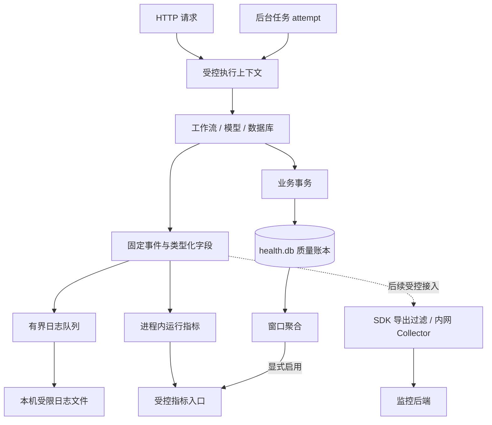

# 可观测性与健康数据保护开发方案

日期：2026-10-27  
状态：已完成本地实现；实现差异、回归与性能验证记录见第 13 节。容器实测及 Windows ACL 验证另行验收。  
对应问题：[架构与安全 Review 建议](架构与安全Review建议.md)第 7.2 节。

## 1. 开发结论与范围

采用“运行元数据白名单 + 请求关联 + 分层耗时 + 事务内业务质量账本”的方案。生产环境默认不采集健康原文、完整 prompt、模型响应、请求体、数据库内容和凭据。

先在当前单 Engine 运行环境中建立可验证的采集边界，再按需要接入 OpenTelemetry Collector 和监控后端。本期不为了观测引入新 worker、消息队列或云端日志服务，也不改变模型调用、计划确认、工作流恢复和医疗安全策略。

区分两类数据：

| 类型 | 用途 | 存储与一致性 |
| --- | --- | --- |
| 运行遥测 | 定位耗时、错误、超时、降级与资源等待 | 受控结构化日志、进程内指标；允许有界丢弃，不承诺崩溃前全部送达 |
| 业务质量账本 | 计算未知率、追问率、纠正率及计划处理数量 | 同一业务库事务内写入，支持幂等、重启和删除；只对外提供获准的聚合结果 |

安全审计继续按业务权限管理。业务质量账本不是完整审计系统，运行遥测也不能替代操作授权及审计。

## 2. 选型依据

### 2.1 参考的通用实践

- OpenTelemetry 建议优先减少敏感数据采集，Collector 可通过属性删除、白名单、过滤和转换提供第二层保护；它不能自行识别本项目的所有健康信息。[官方文档](https://opentelemetry.io/docs/security/handling-sensitive-data/)
- OWASP 建议排除健康信息、令牌和密钥，并验证日志字段、注入防护、访问控制、保留和故障行为；不同目的的监控与审计记录通常需要分开管理。[官方文档](https://cheatsheetseries.owasp.org/cheatsheets/Logging_Cheat_Sheet.html)
- LangSmith 支持隐藏输入、输出、metadata 以及按请求禁用 tracing；Langfuse 支持在导出前过滤观测属性。[LangSmith 文档](https://docs.langchain.com/langsmith/mask-inputs-outputs)、[Langfuse 文档](https://langfuse.com/docs/observability/features/masking)
- Prometheus 建议避免使用用户 ID、邮箱等不受限的指标标签；request ID、thread ID 及其哈希同样不作为指标标签。[官方文档](https://prometheus.io/docs/practices/naming/)

### 2.2 本项目决定

1. 本期不启用自动采集全部 LangGraph state 或模型输入输出的插件。
2. 日志采用固定事件名和类型化字段；不依赖输出后正则替换健康原文。
3. 运行指标采用 Counter、Histogram、Gauge；计划和质量的持久化聚合采用 Gauge 表达可删除、可变化的窗口统计。
4. 使用服务端生成的 HTTP request ID；默认不导出用户、conversation、thread、plan 或 event 标识。
5. 后续接入观测工具时，继续沿用本地字段约束，并审计其默认行为；私有部署不替代最小采集。

## 3. 当前代码基线

以本文编写时的工作区代码为准；其他开发方案中的“未实施”状态可能早于当前代码。

| 文件或对象 | 当前行为 | 本次需要补充 |
| --- | --- | --- |
| `backend/app/common/request_context.py` | `log_failure()` 记录安全错误码、关联 ID、状态 | 统一事件结构、字段注册及输出边界 |
| `backend/app/api/request_context.py` | 每次 HTTP 尝试生成 UUID，覆盖正常响应和安全错误响应 | 请求耗时、结果分类、连接中断及上下文清理 |
| `backend/app/workflows/runtime.py` | 有业务 request_id、幂等重放及请求段 duration_ms | HTTP 尝试、实际执行、重放分别统计；跨恢复关联 |
| `backend/app/workflows/concurrency.py` | `guarded_node()` 保护节点，`model_io()` 在网络期间释放锁 | 固定节点名、等待与执行分层计时、interrupt 分类 |
| `backend/app/modeling/transport.py` | 有限额、超时与固定上游错误映射 | 实际请求耗时、HTTP 类别、传输失败原因 |
| `backend/app/modeling/parser.py` | `Parser.request()` 解析响应并校验输出类型 | 区分传输成功与输出协议成功 |
| `backend/app/infrastructure/repositories/common.py` | `model_calls` 在发送前记账，用于预算 | 保留预算语义，不把预留次数当作成功调用次数 |
| `backend/app/infrastructure/unit_of_work.py`、`budget_connection.py` | 显式写事务、嵌套 savepoint、取消保护 | 最外层事务耗时、提交和回滚结果 |
| `backend/app/jobs/runner.py`、`repositories/jobs.py`、`repositories/outbox.py` | 已有任务执行、租约、attempt 和 outbox | 后台根上下文、队列等待、执行结果与安全失败分类 |
| `backend/app/workflows/chat_flow.py` 等 | `process_trace` 用于业务过程展示，关联业务回复要点 | 不允许复制到日志、span 或异常附件 |
| `Dockerfile`、`deploy/gateway/nginx.conf` | 加固入口关闭访问日志；容器日志限制大小 | 所有启动入口、Python 依赖日志和观测出口统一检查 |
| `backend/tests/test_error_contract.py` | 已测试错误响应及捕获日志不包含敏感标记 | 扩展到成功、恢复、后台任务、所有导出出口 |

本文不读取个人数据库，也不以真实健康记录作为测试夹具。

## 4. 采集与存储边界



### 4.1 禁止进入运行遥测的数据

- 用户健康原文、原文片段及其哈希，包括食物、体重、疾病、用药、过敏和自由文本偏好。
- 完整 prompt、模型响应、工具结果、LangGraph state、checkpoint、pending_input、卡片和 `process_trace`。
- API Key、Authorization、Cookie、会话令牌、任务 lease token、环境变量或 Settings 整体序列化。
- 请求或响应 body、完整 URL、查询参数、用户提交的路径段及任意请求头。
- SQL 原文及绑定参数、数据库导出、行内容、数据库文件、WAL 和转储附件。
- 任意异常字符串、repr、异常链、包含局部变量的堆栈及自动异常事件。
- 医疗风险分类、具体营养数值、用户输入中提取的实体作为标签或事件名。

错误码、类别和节点名必须来自代码内注册表。不能因为一个字段名是 `reason`、`metadata` 或 `error_code` 就允许任意字符串进入。

### 4.2 不同标识的职责

| 标识 | 规则 |
| --- | --- |
| HTTP request ID | 沿用服务端生成的 UUID；不信任客户端同名 header；可在响应头和安全日志关联 |
| 业务 request_id | 保留幂等语义，仅在业务系统使用；不直接写运行日志 |
| operation ID | 每次实际执行段生成随机内部标识；重放请求可以没有新的执行段 |
| thread 关联 | 默认关闭；确有跨恢复排障需求时，用 HMAC-SHA256 对固定用途前缀与内部 thread ID 计算关联值 |
| 后台执行 | 每次任务 attempt 建立独立 operation ID；重试生成新 ID，lease token 永不导出 |

thread 关联使用独立秘密文件中的密钥，不能复用模型 API Key。带 `key_version`，轮换后只保证同一密钥周期内的关联；密钥缺失时拒绝启用该功能。保留完整 256 位结果，不哈希健康文本，也不把关联值当成匿名数据。

运行上下文使用 ContextVar，进入和退出用 token 恢复。FastAPI 同步线程池、LangGraph 内部执行线程及后台 runner 的传播都必须测试；新建线程显式传递最小上下文，不假设自动继承。心跳线程另建最小上下文，不能捕获用户 state。后台任务不得继承派发请求的健康内容或遗留 request ID。

## 5. 统一事件接口

新增 `backend/app/observability/`。业务代码调用固定接口，不直接传递 `**state`、`**request`、异常对象或任意字典。

```python
# 接口示意，具体类型由事件注册表提供。
emit(ModelTransportFinished(
    purpose=ModelPurpose.ESTIMATE_NUTRITION,
    duration_seconds=1.23,
    http_status_class=HttpStatusClass.SUCCESS,
    outcome=TransportOutcome.OK,
))
```

输出示例，全部为合成元数据：

```json
{
  "schema_version": 1,
  "timestamp": "2026-10-27T02:00:00Z",
  "event": "model_transport_finished",
  "component": "model_transport",
  "request_id": "6f299cee-f50a-40ef-a49c-fc7ba61f0258",
  "operation_id": "2c6e236f-e3ea-45c6-902a-3dafeddb503b",
  "purpose": "estimate_nutrition",
  "duration_seconds": 1.23,
  "http_status_class": "2xx",
  "outcome": "ok"
}
```

校验规则：

1. 每个事件定义专属允许字段、枚举、数值范围和可空项；拒绝未知字段及任意嵌套对象。
2. 时间统一 UTC；耗时使用单调时钟。业务统计日使用 Asia/Shanghai。
3. 标识验证 UUID 或已定义 HMAC 格式；路由、节点、用途和版本来自服务端固定注册表。未匹配路由统一 `unmatched`，不使用原始路径兜底。
4. 禁止 NaN、Infinity、负耗时；限制单条序列化事件为 4 KiB。
5. 不合法事件丢弃并增加固定 `reason` 的观测丢弃计数；不能记录被拒绝的值。日志故障处理不得递归写日志。
6. JSON 编码避免换行伪造；不输出 `LogRecord` 整体、`exc_info`、`stack_info` 或额外上下文。
7. 保留 `log_failure()` 的调用兼容，在内部映射到新接口；未知 code 映射为固定占位码。

进程启动时配置所有输出 handler。Uvicorn access 日志关闭；HTTPX、HTTPCore、LangGraph 及其他第三方未受控消息不得直达文件或 stderr。确需保留库级事件时，只转换为固定组件和固定类别，不保留原消息、参数和异常。仅设置 root logger 级别不足以完成隔离，需要检查子 logger 独立 handler 与 propagation。

## 6. 运行耗时与结果

### 6.1 HTTP 与工作流

- HTTP 计时覆盖本次请求从进入中间件到最后响应体或中断；记录路由模板、受限 method、响应状态类别和结果。
- 已返回 200 后发生断连或响应结束异常时，状态类别与最终 outcome 分开表达。响应未开始时使用 `none`，不能伪造 HTTP 状态。
- 每次网络重试都是一次 HTTP attempt；receipt 重放记 `replayed`，不重复增加工作流执行或业务质量分母。
- 工作流执行段按 run/resume 分开计时；用户等待几小时不计入节点或模型耗时。
- 节点注册时显式传入固定 node key；不能直接用 lambda 名称或用户输入生成 span 名。
- `guarded_node()` 在取得 engine 锁之前计时等待，取得后开始节点 wall time。节点耗时包含内部模型调用；各层耗时存在包含关系，不能相加作为总耗时。
- LangGraph interrupt 按已安装版本的控制流类型识别，记为 `interrupted`；取消、执行期限、版本冲突和程序错误分别分类。不为计时吞掉控制流异常或改变返回行为。

### 6.2 模型

采用三个不同层次：

| 层次 | 开始和结束 | 结果示例 |
| --- | --- | --- |
| 预算预留 | 现有 `account_model_call()` | 已预留，保留现有预算含义 |
| 传输 | `fetch_model()` 发起实际调用到读取或失败结束 | `ok`、`timeout`、`network_error`、`proxy_error`、`http_error`、`cancelled`、`response_invalid`、`response_too_large` |
| 模型契约 | `Parser.request()` 发起调用到输出 Schema 校验结束 | `ok`、`transport_failed`、`envelope_invalid`、`schema_invalid`、`cancelled` |

下游业务对来源证据或策略的拒绝在对应验证点记录固定 `model_output_rejected` 类别，不伪装成 HTTP 失败。HTTP 2xx 不代表输出可用。

超时可按 connect/read/write/pool/overall 使用固定 stage；执行预算耗尽与上游超时分开。保留现有对外错误响应映射，不向客户端透传供应商响应体、header 或 URL。

fallback 在本地代码真正采用替代路径时记录，按调用点固定 purpose 和 reason 去重。正常 local_only、演示模式、策略规定的本地安全回复不计为模型失败降级。营养缺失因降级而保持未知，不能因指标改善而填零或使用演示估算。

如供应商提供 token 用量，仅解析明确的非负数值并限制范围；缺失表示未报告，不能补零。成本估算依赖版本化价格配置，后续另行增加，不通过日志抓取响应正文。

### 6.3 数据库与锁

- `BudgetLock` 增加固定 lock role：engine、repository、workflow、conversation；不导出锁 key。只统计最外层获取，避免 RLock 重入被当作额外排队。
- 事务计时从实际开始写事务到最外层 commit/rollback 完成；仅使用连接上下文而未开启事务的读操作不记为写事务。
- `atomic()`、隐式写入与 `BudgetConnection.__exit__()` 需要协调，避免同一事务双计；嵌套 savepoint 不增加最外层事务数。
- 分别记录数据库 role 为 business、checkpoint、job_heartbeat。心跳连接也要受控埋点。
- 不改变取消、租约校验、savepoint 和 commit fencing 的顺序；日志队列写入及外部导出不能发生在持有业务锁的阻塞路径中。
- Python 锁等待可以直接测量。SQLite 的 `BEGIN IMMEDIATE` 调用耗时只是获得写入权的外部耗时代理，不等于精确的 SQLite 内部锁等待。使用 `write_begin` 阶段耗时与原生 busy/locked 错误类别表达；不通过匹配异常文案分类。
- 禁止启用 SQL trace callback 或把 SQL 与绑定参数交给自动数据库埋点。

### 6.4 后台任务

在现有 `JobRunner.run_one()`、失败处理、租约过期恢复与 outbox 消费点补充固定事件。任务 kind 来自任务契约，不记录 payload、logical_key、result_ref、worker_id 或 lease token。

队列等待从当前 attempt 的就绪时间到实际领取计时，执行耗时从领取到该次完成计时；历史补跑日期不能直接当作排队时长。心跳、attempt、lease_lost 与最终 job 状态分别统计，重试失败不提前记为最终失败。进程被强制终止无法保证产生结束事件，由原有监督、attempt 恢复和租约过期记录补足，不能在重启时补造一次成功。

## 7. 指标契约

### 7.1 运行指标

以下均为拟新增，单位统一秒；枚举组合由 MetricSpec 限定，不接受任意字符串 label。

| 指标 | 类型 | 允许标签 |
| --- | --- | --- |
| `health_http_requests_total` | Counter | route、method、status_class、outcome |
| `health_http_request_duration_seconds` | Histogram | route、method |
| `health_workflow_attempts_total` | Counter | kind、operation、outcome |
| `health_workflow_node_duration_seconds` | Histogram | kind、node |
| `health_model_transport_total` | Counter | purpose、status_class、outcome |
| `health_model_transport_duration_seconds` | Histogram | purpose |
| `health_model_contract_total` | Counter | purpose、outcome |
| `health_model_fallback_total` | Counter | purpose、reason |
| `health_db_transaction_duration_seconds` | Histogram | database、outcome |
| `health_db_write_begin_duration_seconds` | Histogram | database |
| `health_db_busy_total` | Counter | database、category |
| `health_lock_wait_duration_seconds` | Histogram | role |
| `health_job_attempts_total` | Counter | kind、outcome |
| `health_job_queue_wait_seconds`、`health_job_execution_duration_seconds` | Histogram | kind |
| `health_observability_dropped_total` | Counter | sink、reason |
| `health_observability_queue_depth` | Gauge | 无 |

HTTP 和模型直方图初始桶采用 0.01、0.05、0.1、0.25、0.5、1、2、5、10、30、60、120、180 秒；数据库和锁采用 0.001、0.005、0.01、0.05、0.1、0.5、1、5、30、120 秒。库自动提供无限上界。调整桶需版本评审，不能按用户输入动态生成。

运行 Counter 在进程重启后重置，通过监控查询处理 reset；不声称它们是账务式精确计数。日志可以采样，指标在日志采样前记录；本期先用有界日志和固定级别，暂不增加复杂采样策略。

### 7.2 持久化质量口径 v1

质量窗口为最近 30 个 Asia/Shanghai 自然日，按对象首次纳入时的 cohort_day 统计。分母为零时结果为不可计算，不输出 0% 或 100%。只统计功能启用后发生、经过明确业务提交的新对象；旧数据不回填推测。

| 指标 | 分子 / 数量 | 分母 / 说明 |
| --- | --- | --- |
| 营养未知率 | 首次保存餐食时，对应营养字段为 None 的食物项数 | 同批首次保存的食物项总数；kcal、protein_g、carbs_g、fat_g 分别统计 |
| 必需追问率 | 至少一次进入已提交的必需信息追问状态的聊天工作流数 | 已登记的聊天工作流数；不含计划确认、建议反馈等可选提问 |
| 记录纠正率 | 窗口内新建记录中，至少发生一次已提交用户纠正的记录数 | 同一 cohort 的新建记录数；按记录计，不按消息、纠正次数计 |
| 计划处理数量 | pending、active_decision、rejected、cancelled、stale、expired 各状态对象数 | 同窗口创建的唯一计划对象；是处理结果分布，不是当前生效计划数 |

补充语义：

- 营养未知率度量首次落库质量；后续纠正不回写该指标，可另设指标版本，不能静默改为“当前快照未知率”。
- 追问采用进行中的创建 cohort，因此最近日期尚未成熟，需要展示分子、分母和窗口；不能用它直接评价解析准确率。
- 纠正必须明确来源为用户操作；自动重估、导入和内部迁移不计。对同一记录多次纠正，分子仍只为 1。
- 重试、receipt 重放、节点重放、重复 resume 不重复增加分子和分母。已部分保存的多条独立记录按各自提交统计。
- `active_decision` 指确认时成功激活，之后被新计划 supersede 不改写历史决策结果；自动生效与人工确认使用固定 decision_source 区分。
- 当前取消流程可能把 pending plan 写成 rejected，但统计必须在真实操作入口区分取消和显式拒绝，不能从最终 plans.status 倒推。
- stale 表示依据变化导致失效；expired 表示等待 TTL 到期。清理一个已完成工作流不算计划过期，重复清理也不能增加数量。
- 用户拒绝计划和纠正记录都是行为信号，不能直接解释为模型错误或安全事故。
- mode 仅使用固定 `local_only`、`model_allowed`、`demo`；本地质量查询可分组，默认不对外导出额外细分。model_allowed 不代表实际发生过模型调用。

## 8. 事务内质量账本

### 8.1 数据结构

新增 `quality_observations` 表，作为业务库中的受控派生元数据，不作为普通运维日志。

| 字段 | 约束 |
| --- | --- |
| subject_type、subject_id | event/workflow/plan 与内部对象 ID，只留在业务库 |
| metric_key | nutrition_unknown、required_clarification、record_corrected、plan_outcome 固定枚举 |
| measure | none/kcal/protein_g/carbs_g/fat_g 固定枚举，按 metric_key 限定合法组合 |
| metric_version | 初始为 1，不混合不同口径 |
| cohort_day | Asia/Shanghai 的首次纳入日期；不是健康事件发生日期 |
| numerator、denominator | 非负整数，比例项满足 numerator <= denominator；plan_outcome 两者均为 1 |
| outcome | 仅 plan_outcome 使用第 7.2 节固定状态，其余为 none |
| mode、decision_source | 固定枚举，按指标限制组合；来源无法确认时不能臆造为人工 |

唯一键为 `(subject_type, subject_id, metric_key, measure, metric_version)`，不包含会发生变化的 outcome。采用显式列与 CHECK 约束，不添加任意 JSON metadata、正文或 prompt 列。

迁移号从实施时工作区实际 schema 版本递增，不能照搬旧文档中的版本号。迁移只建结构，不推断历史指标。

### 8.2 写入位置与重放

1. 注册新的聊天工作流时，同事务插入 required_clarification 的 0/1 观察值。首次必需追问结果提交时更新为 1/1；任意节点重放只复用已有行。
2. `save_events()` 在首次新建记录的事务内插入 record_corrected 的 0/1，以及餐食的各营养字段计数；首次用户纠正更新原观察值为 1/1，不修改 cohort_day。
3. `save_plan()` 真正插入新计划时，同事务登记 pending。决策成功、显式拒绝、取消及 TTL 清理在实际状态转换事务内更新；未发生转换时不更新。
4. 若仓储调用被外层事务包裹，质量行遵循外层提交与回滚。不能在中间 savepoint 释放后向外部平台报告业务成功。
5. 唯一约束和条件更新保证单对象每个指标只有一个贡献；不依赖进程内 set 去重。

本期无需为质量统计扩展现有调度 outbox。其当前用途是周复盘到计划任务的事务交接，不应将其中 payload 镜像到日志。未来向外部推送聚合快照时，再独立设计幂等快照协议，不宣称消息投递天然 exactly-once。

### 8.3 聚合与保留

按固定 metric_key、measure、outcome 和窗口聚合，不返回 subject_id。质量聚合使用 Gauge，例如 `health_quality_numerator`、`health_quality_denominator` 和 `health_plan_cohort_count`；window 固定 `30d`，不把任意日期或对象作为 label。

账本仅保留最近 30 个统计自然日；按日有界清理。对窗口外记录的迟到纠正不重新建立 cohort，也不补造分母。重启从账本重建质量快照；运行指标另按进程语义重置。

### 8.4 删除与故障语义

- subject 字段是关联信息，账本仍受健康业务数据权限约束。对目标及依赖对象删除时，通过明确所有权映射删除相应质量行，并在同一业务阶段提交；不能把“没有原文”当作无限保留的理由。
- 删除预览纳入质量元数据的清理数量；工作流过期清理或消息清理是否仍保留对应主体，按现有保留规则执行，不能留下无主关联行。
- 聚合快照在删除后重新计算，允许减少，因此不用单调 Counter 表达。旧监控历史点不会因当前 Gauge 下降自动消失；本期质量外发默认关闭，未来启用须同时明确外部删除与保留能力。
- 运行遥测的队列满、文件不可写或 exporter 不可用，不改变业务结果。质量账本属于同库事务一致性约束，写入失败按数据库事务错误回滚，不能吞掉错误后宣称统计精确；此限制与“运行遥测故障不阻断业务”分开验收。
- 事务提交后的快照刷新失败允许暂时陈旧，恢复后重建；不能让 exporter 故障回滚已提交业务。

## 9. 配置、部署和权限

### 9.1 拟新增配置

| 配置 | 默认 | 规则 |
| --- | --- | --- |
| `OBS_ENABLED` | true | 关闭运行遥测；不改变业务质量账本事务与清理规则 |
| `OBS_LOG_LEVEL` | INFO | 固定枚举；本期不允许通过 DEBUG 打开健康内容采集 |
| `OBS_METRICS_ENABLED` | false | 显式开启内部运行指标入口 |
| `OBS_QUALITY_EXPORT_ENABLED` | false | 只有 metrics 开启且满足受控部署条件才允许开启 |
| `OBS_THREAD_LINK_ENABLED` | false | 开启时要求独立密钥文件及固定 key version |
| `OBS_THREAD_LINK_KEY_FILE` | 空 | 读取受限秘密文件；配置错误不打印文件内容或密钥 |
| `OBS_THREAD_LINK_KEY_VERSION` | 空 | 格式和长度受限，不能使用任意配置字符串作标签 |

首期固定：日志队列 1024 条、事件上限 4 KiB、本机文件总预算 30 MiB、最多保留最近 7 个 UTC 自然日。后续如提供可调配置，必须有合法范围和验证测试。

### 9.2 输出与保留

应用安全日志写入 `DATA_DIR/observability/`，按 UTC 日期分片并按大小轮转，启动及周期清理；先检查日期，再执行全目录总容量预算，必要时提前删除最旧日志。不能使用原始输入构造文件名。目录为应用专用目录；Linux 目录 0700、文件 0600，Windows 验证应用账户 ACL。

日志异步写入且队列有界。业务线程只尝试非阻塞入队，队列满丢弃运行事件；不可阻塞等待磁盘或网络。关闭进程时最多等待 2 秒刷盘，超时允许丢弃。硬退出、磁盘故障和缓冲数据丢失属于已知边界。

Python 其他 handler 不能绕过出口。stdout/stderr 只允许经过同样规则的必要启动和监督事件，避免保留第二份无控制的应用日志。现有 Docker json-file 的 10 MiB × 3 是大小限制，不提供按天删除承诺；宿主机与集中日志的额外保留需另行配置和验证。

### 9.3 指标入口与健康数据外发

拟新增 `/internal/metrics`，不增加到前端 API，不返回原文或对象标识。开发模式限本机；加固模式在 Nginx 中显式拒绝 `/internal/`，应用端口不映射宿主机，指标只允许指定内部采集网络访问。不能仅靠 CORS 保护，也不能为了抓指标打开应用公网端口。

默认不外发质量指标。项目是单用户应用，精确时间段里的纠正数、计划数或营养未知计数也可能透露个人行为，不能直接视为匿名统计。后续多用户系统是否采用更粗时间粒度、小群体抑制等措施，需单独设计；本期不承诺差分隐私或匿名化。

### 9.4 后续接入 OpenTelemetry / LLM 平台

应用内白名单始终有效，Collector 作为第二道过滤并部署在受控网络内。开启自动埋点前检查 span 名、attributes、events、resource、links、baggage、异常和所有 exporter；删除属性不能覆盖其他字段的泄露。

LangSmith 需同时隐藏输入输出并过滤 metadata、错误及附件；Langfuse 导出 hook 的作用范围需按实际 SDK 版本验证，不能推断它会处理其他 exporter 或媒体附件。本期无媒体观测，不上传附件。固定依赖版本，用捕获 exporter 验证实际发送内容后才能启用；采样仅控制成本，不作为隐私措施。

## 10. 开发任务与文件范围

以下为建议新增或修改范围；不覆盖已有未提交工作，按当前代码增量实施。

| 任务 | 文件范围 | 交付与依赖 |
| --- | --- | --- |
| T1：事件与指标契约 | 新增 `backend/app/observability/contracts.py`、`context.py`、`metrics.py` | 固定事件、类型、标签、桶、上下文和无操作实现；作为后续基础 |
| T2：受控出口 | 新增 `observability/logging.py`；修改 `common/request_context.py`、`common/config.py`、`main.py` | 有界队列、轮转、保留、依赖日志隔离和生命周期；依赖 T1 |
| T3：请求与节点 | 修改 `api/request_context.py`、`workflows/runtime.py`、`concurrency.py`、图注册点及 `common/execution_budget.py` | HTTP、run/resume/replay、节点和锁分层；依赖 T1/T2 |
| T4：模型与降级 | 修改 `modeling/transport.py`、`parser.py`、`health/nutrition.py`、`chat/replies.py`、`workflows/chat_response.py` 及安全降级入口 | 传输与契约结果、固定原因降级；依赖 T3 |
| T5：数据库与后台 | 修改 `infrastructure/budget_connection.py`、`unit_of_work.py`、连接初始化、`jobs/runner.py` 和租约恢复点 | 事务、锁、心跳、队列与 attempt 耗时；依赖 T1/T2 |
| T6：质量账本 | 新增 `infrastructure/repositories/observability.py`；修改数据库迁移、仓储组装、events/workflows/planning 写入点和 `privacy/deletion.py` | 幂等贡献、窗口聚合、删除及恢复；依赖 T1，遵循当前事务边界 |
| T7：内部指标与部署 | 新增 `api/observability.py`；修改 `main.py`、Nginx 配置、启动命令、`.env.example`、依赖文件 | 指标入口默认关闭，外部拒绝访问；依赖 T1/T5/T6 |
| T8：验证与交付记录 | 新增观测测试、部署合成探测及本文验收记录 | 覆盖各任务；未完成项明确保留为未验收 |

运行指标可使用 `prometheus-client`，实施时选定兼容版本并更新 `backend/requirements.txt` 与锁定文件，不自行实现 Prometheus 文本协议。首期不引入 OpenTelemetry 或 LLM 观测 SDK；后续接入复用已有契约。

## 11. 验收与测试

### 11.1 必须通过的验收条件

| 编号 | 验收条件 | 建议验证位置 |
| --- | --- | --- |
| AC-01 | 合成健康原文、prompt、模型响应、凭据与 SQL 参数均不进入任一采集出口 | `test_observability_privacy.py` |
| AC-02 | 未知字段、任意错误码、换行注入和超长事件被丢弃，且不回显被拒绝值 | `test_observability_contracts.py` |
| AC-03 | HTTP、同步线程池、节点、resume 和后台 attempt 关联正确，结束后不串上下文 | `test_observability_context.py` |
| AC-04 | 模型超时、网络、HTTP 错误、响应过大、非法 JSON、Schema 失败和本地拒绝可以区分 | `test_observability_model.py` |
| AC-05 | 正常本地模式不增加 fallback，真正降级一次只计一次 | 模型与工作流观测测试 |
| AC-06 | interrupt 不算程序错误；用户等待不进入执行耗时；重放不新增执行次数 | `test_observability_workflow.py` |
| AC-07 | 重入锁、嵌套事务不双计，回滚、busy、期限和租约取消保留原行为 | `test_observability_database.py` |
| AC-08 | 业务事务回滚无质量贡献；重启、重试、重复确认与多次纠正均不重复计数 | `test_observability_quality.py` |
| AC-09 | 同 cohort 分母正确，零分母为不可计算；stale、TTL、取消与拒绝分别统计 | 质量口径测试 |
| AC-10 | 删除预览覆盖账本，删除后没有对应主体关联行，窗口聚合重算 | 质量与现有隐私删除测试 |
| AC-11 | 队列满、日志目录不可写和关闭超时不改变业务返回；丢弃计数可见 | `test_observability_failures.py` |
| AC-12 | 指标无 ID 或任意字符串标签，路由不含真实路径；网关拒绝指标入口 | 指标契约与部署探测 |
| AC-13 | 清理满足日志日期与总容量限制、质量窗口规则；容器日志限制不被误写为 TTL | 保留策略测试 |
| AC-14 | 观测关闭、开启两种模式下，现有 API 错误、安全路由、幂等和恢复回归一致 | 现有相关回归测试 |

### 11.2 隐私验证方法

使用固定合成敏感标记，分别放入用户文本、未知请求字段、查询参数、URL 路径、供应商响应、异常文案、假 Authorization、数据库参数及后台 payload。检查 caplog、stdout/stderr、实际日志文件、指标响应和捕获的导出批次，不能只检查用户响应。

覆盖成功、校验失败、异常、interrupt/resume、fallback、删除、任务失败和重启恢复。测试使用临时业务库与 checkpoint，不构造指向个人 data 目录的 Engine；不访问真实模型 API，不把敏感标记写进测试摘要或诊断附件。

### 11.3 性能与验证记录

用相同合成负载比较关闭与开启观测时的请求延迟、队列峰值和事务耗时；模型使用 MockTransport。初始目标为本地固定负载 P95 增量不超过 5%，该值是本项目预算，不是业界统一标准。若机器噪声使结果不稳定，报告负载、样本量、基线和误差，不把它作为不可靠的单次 CI 断言。

先运行新增测试及现有 error_contract、model_transport_limits、workflow_concurrency、resume_recovery、privacy_deletion 等相关回归；涉及后台账本时追加任务恢复与租约测试。再按仓库已有要求运行完整后端检查与部署探测，不为纯文档提交执行应用测试。

交付记录放入 `docs/evidence/observability-validation-summary.json`，只含日期、代码版本、执行的测试、结果、统计和未验收项；不得包含健康样本、模型正文、数据库快照或环境变量。只有真实运行后才创建结果记录。

## 12. 实施与回退

1. 先完成契约、出口隔离与隐私测试，再接业务埋点；避免在尚未受控的 logger 上先增加数据。
2. 增加运行耗时和失败分类，验证现有安全与恢复语义，再引入质量账本迁移。
3. 完成质量幂等、删除和重启验证后，在本机合成场景启用；指标入口及质量外发仍保持默认关闭。
4. 部署验收通过后按需要开启运行指标。接入外部服务另行配置目的地、权限和保留，不默认扩大当前网络允许范围。

`OBS_ENABLED=false` 可快速关闭运行日志及运行指标，不停止质量账本必要的写入与清理。暂时关闭质量采集必须记录为新的统计覆盖间隙，恢复时不得跨缺口报告完整样本。回退代码前确认迁移兼容性，不删除业务库或修改现有 receipt/checkpoint 来关闭观测。

前述章节保留设计约束；以下记录本次实现和实际验证，不将配置文件检查视为部署实测。

## 13. 实现与验证记录

### 13.1 已实现范围

- 新增 `backend/app/observability/`：事件和标签白名单、最小执行上下文、独立 Prometheus registry、有界日志队列、文件轮转和保留。
- HTTP 请求、run/resume/replay、固定节点、模型传输和输出契约、现有 fallback、事务、锁争用、后台 attempt 和 outbox 已接入受控观测。
- 沿用原 HTTP UUID，业务幂等键不导出；thread 关联默认关闭，可使用独立文件密钥计算 HMAC，日志包含受限 key version。
- 日志入口校验后才 JSON 编码；Python LogRecord factory 清除未受控库消息、格式化参数及异常链。LangGraph 调用显式使用 `tracing_context(enabled=False)`，不受环境中的内容 tracing 开关影响。
- schema 9 新增质量账本和主体删除触发器；营养、必需追问、用户纠正和计划结果在业务事务内更新，幂等重放不增加贡献。旧 schema 8 不重新执行旧任务迁移，也不回填历史质量值。
- 隐私删除预览包含 `quality_observations` 数量，删除或清理对应主体时移除质量贡献；聚合按请求重建，已删除的指标序列不会继续留在本地缓存。
- `/internal/metrics` 默认关闭；开发环境只接受回环客户端，Nginx 拒绝 `/internal/`。质量外发还需要独立开关，不因运行指标启用而自动启用。
- 新增 `backend/tests/test_observability.py`，覆盖隐私、类型、线程上下文、队列和磁盘故障、模型契约、质量事务、窗口、计划状态、后台 attempt、内部入口及删除。

### 13.2 对设计的具体落实与边界

| 项目 | 最终实现说明 |
| --- | --- |
| 锁等待口径 | 只记录实际进入阻塞获取的等待；无竞争获取、非阻塞探测和重入不进入直方图。其分位数表示有竞争时的等待分布，不代表所有加锁操作的平均等待 |
| 日志写入 | 最多 32 条、最多等待 20 ms 组成一次后台追加；每条仍先通过 4 KiB 白名单校验。业务线程只做非阻塞入队 |
| 标签实例缓存 | 只缓存验证通过的固定标签组合，减少 Prometheus 客户端重复查找；不缓存任意用户字符串 |
| checkpoint 事务 | Saver 使用 Cursor 写入，单独记录游标写入范围到 commit/rollback 的时间；不采集 SQL，也不改变现有执行权校验与回滚顺序 |
| 计划统计 | 使用 `health_plan_cohort_count`，按 outcome、decision_source、固定 30d 窗口聚合；比例指标使用 numerator/denominator Gauge |
| 租约恢复 | 使用独立 `health_job_recoveries_total`，避免把一次租约过期恢复误算成新增执行 attempt |
| 风险信息 | 运行日志将已注册的具体 safety 错误码收敛为 `safety_policy_blocked`；API 对用户的原错误契约保持原有行为 |
| 观测开关 | 关闭运行遥测仍保留库日志脱敏边界和质量事务，不能借此打开原文日志 |
| 质量清理 | 启动、相关业务提交和定时规划时清理窗口外贡献；查询始终排除窗口外行。禁用调度并完全空闲时，物理清理延至后续操作或重启 |
| Token 与成本 | 本期不采集响应 usage，不估算成本；没有报告的 token 不补零，不读取响应正文补造数据 |
| 外部平台 | 未引入 OpenTelemetry、LangSmith 或 Langfuse 的外发 exporter，也未新增外部网络目的地 |
| 权限与部署 | Linux 日志目录 0700、文件 0600；Windows 继承应用账户目录权限。本次不声称已通过 Windows ACL 或真实容器网络验收 |

### 13.3 本地验证

最终执行记录见 [观测验证摘要](evidence/observability-validation-summary.json)。验证使用临时数据库、合成标记和 MockTransport，没有读取或迁移个人 `data/` 数据库，也没有调用真实模型供应商。

2026-10-27 最终全量后端回归：579 项通过，0 项失败，耗时 130.51 秒；其中新增观测用例 41 项。`pip check` 与差异空白检查通过。网关检查为配置断言，不代表已在运行容器中抓取或验证网络隔离。

首次完整回归暴露了未授权模型调用的异常被计时器覆盖的问题，已将授权消费移到计时之前；相关边界测试和后续全量回归验证该路径继续抛出原有 PolicyError。性能优化前后均保留测量结果，不以某一次最快结果替代全部轮次。

性能脚本：

```powershell
.\.venv\Scripts\python.exe scripts/benchmark-observability.py --samples 50 --rounds 4
```

每种模式 200 个样本，每轮预热 5 次，交替先运行开启与关闭模式；仅执行本地合成工作流，不开启调度或模型网络调用。初始测量 P95 增幅约 12.1%，批量写入后仍约 12.2%；进一步消除无竞争锁的高频直方图更新后，一次测量降至约 3.0%。包含最终 checkpoint 埋点的复核为约 4.85%，达到本次 5% 预算。所有轮次及局限保存在验证摘要中，不外推为真实模型请求的生产性能保证。

部署前仍需使用实际运行账户验证 Windows ACL，或在目标 Linux 容器中验证文件权限、网关不可达、日志清理和宿主机日志保留。未完成的运维验收不会被本地单元测试标记为通过。
