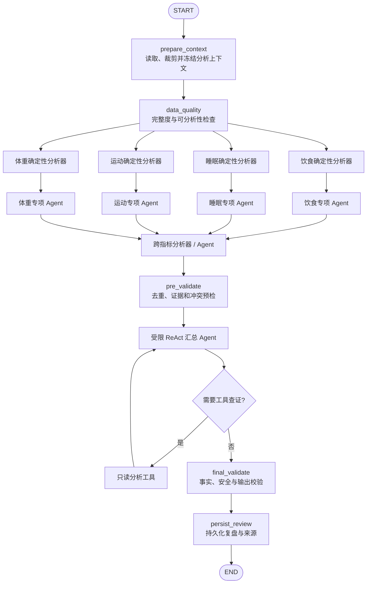
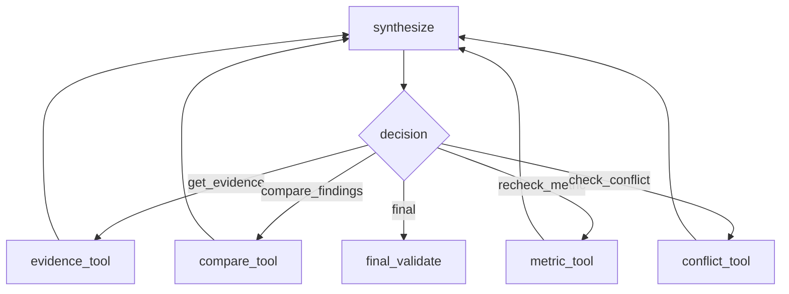

# 复盘设计 v1.0

日期：2026-10-31  
状态：设计稿，尚未实施  
适用范围：健康观察、日复盘、周复盘及后续多 Agent 综合分析  

## 1. 文档目的

本文定义复盘能力从当前“本地规则统计工作流”演进为“确定性分析器 + 专项 Agent + 受限 ReAct 汇总 Agent”的目标架构。

设计目标不是让模型替代统计程序，而是在保留现有数据完整性、证据追踪、本地模式和可复现能力的基础上，引入多 Agent 的专业分工、跨指标解释和综合表达能力。

核心原则：

> 本地代码负责算得对，专项 Agent 负责解释单一领域，汇总 Agent 负责查证、消解冲突和组织报告。

## 2. 当前实现

### 2.1 三张工作流图

当前 `Engine` 在初始化时构建三张 LangGraph 图：

| 工作流 | 作用 | 当前特点 |
| --- | --- | --- |
| `chat_graph` | 记录、纠错、查询和对话 | 包含安全检查、解析、追问、持久化和回复 |
| `plan_graph` | 生成、确认和激活计划 | 包含安全检查、人工确认中断和计划生效 |
| `analysis_graph` | 发现规律并生成复盘 | 两个顺序节点，无模型推理、无人工中断 |

构建入口位于：

- `backend/app/workflows/engine.py`
- `backend/app/workflows/planning.py`
- `backend/app/workflows/runtime.py`

### 2.2 当前 analysis_graph

当前流程为：


`analyze` 调用 `backend/app/health/analysis.py::analyze()`：

1. 读取截至 `period_end` 的近 28 天结构化记录。
2. 使旧的内置滚动规律失效。
3. 分析“前一日睡眠与次日完整饮食摄入”的关系。
4. 分析工作日与周末的完整饮食摄入差异。
5. 保存带样本量、覆盖率、局限性、算法版本和证据引用的 insight。
6. 达到重要性阈值且用户开启通知时生成通知。

`review` 调用 `backend/app/health/analysis.py::review()`：

1. 日复盘读取 1 天，周复盘读取 7 天。
2. 统计记录数、有效记录天数、完整饮食天数、平均摄入、体重变化、平均睡眠和运动时长。
3. 只使用用户明确标记完整且营养数据齐全的日期计算平均摄入。
4. 引用当前有效 insights 和原始记录证据。
5. 将结果写入 reviews，并作为工作流卡片返回。

### 2.3 当前实现的性质

当前分析属于本地、确定性规则算法：

- 没有大模型参与统计或解释。
- 阈值、分组和公式固定在 Python 代码中。
- 相同数据、相同算法版本和相同结束日期应得到相同结果。
- `analysis_graph` 主要提供统一调用、checkpoint、幂等、重试和运行记录。
- 日定时复盘直接调用 `review()`；周定时复盘执行完整 `analysis_graph`。
- 小程序复盘页只读取 `/insights` 和 `/reviews`，不在前端执行分析。

### 2.4 当前不足

1. 只有睡眠—摄入和工作日—周末两类规律，分析维度有限。
2. 规则输出以事实描述为主，缺少跨指标综合解释。
3. `analysis_graph` 是简单线性流程，没有发挥图编排和并行执行能力。
4. 新增分析维度时容易继续堆积在单个 `analyze()` 函数中。
5. 缺少统一的分析结果协议，不利于去重、冲突处理和多分析器协作。
6. 当前没有独立的汇总与终检阶段。

## 3. 目标与非目标

### 3.1 目标

1. 将分析逻辑拆分为可注册、可测试、可版本化的专项分析能力。
2. 支持饮食、睡眠、运动、体重和跨指标分析并行执行。
3. 统一所有分析输出为结构化 `Finding`，禁止只返回自由文本。
4. 保留本地确定性计算作为数字和统计事实的唯一来源。
5. 引入受限汇总 Agent，处理重点选择、结论去重、口径差异和跨领域组织。
6. 仅在需要查证或解决冲突时启用受限 ReAct 循环。
7. 每个结论能够追踪到输入窗口、算法/模型版本和原始证据。
8. `local_only` 模式不依赖外部模型，也能生成完整的基础复盘。
9. 在数据不足时明确返回不足原因，不制造结论。
10. 保持日/周复盘接口和前端数据结构可渐进兼容。

### 3.2 非目标

v1.0 不包含：

- 医疗诊断、疾病预测或治疗方案生成。
- 由模型直接计算平均值、趋势、样本量或显著性。
- 让 Agent 执行任意 SQL 或访问未授权数据。
- 让汇总 Agent 修改原始记录、激活计划或直接发送通知。
- 多个 Agent 之间无限制自由对话。
- 用模型结论替代现有安全规则和计划确认机制。
- 为了“多 Agent”形式而强制每个维度调用模型。

## 4. 总体架构

### 4.1 目标流程



实现时不要求第一期一次完成全部节点，详见第 15 节演进计划。

### 4.2 分层职责

| 层级 | 负责 | 不负责 |
| --- | --- | --- |
| 数据准备层 | 固定时间窗口、读取授权数据、生成不可变快照 | 推断健康结论 |
| 数据质量层 | 完整度、重复、缺失、样本是否可用 | 用自由文本解释原因 |
| 确定性分析器 | 数值计算、分组、趋势、阈值和证据绑定 | 自由扩展因果解释 |
| 专项 Agent | 解释本领域 Finding、生成候选表述和局限性 | 重算数字、访问其他领域完整数据 |
| 跨指标分析层 | 检查多个指标是否在同一窗口共同变化 | 宣称因果关系 |
| 汇总 Agent | 选重点、去重复、解释口径、组织综合报告 | 创建输入中不存在的统计事实 |
| 校验层 | 契约、安全、证据、因果和权限检查 | 为不合格结果补写事实 |
| 持久化层 | 保存版本、来源、报告和运行信息 | 改写原始记录 |

## 5. 专项分析能力

### 5.1 饮食分析

确定性部分：

- 完整饮食天数和数据覆盖率。
- 平均摄入及宏量营养构成。
- 用餐时间和餐次稳定性。
- 工作日与周末差异。
- 目标范围内、偏高或偏低的持续性。
- 未知营养项和估算数据占比。

Agent 部分：

- 将多个饮食 Finding 归并成易懂的观察。
- 区分“记录变化”与“真实摄入变化”。
- 在证据允许范围内解释饮食结构变化。
- 输出可执行但非诊断性的下一步观察建议。

### 5.2 睡眠分析

确定性部分：

- 平均睡眠、分位数和波动。
- 连续不足或连续改善天数。
- 工作日与周末睡眠差异。
- 睡眠记录覆盖率。

Agent 部分：

- 解释稳定性和阶段变化。
- 明确区分单日异常与重复模式。
- 结合用户目标选择报告重点。

### 5.3 运动分析

确定性部分：

- 运动频率、总时长和连续性。
- 与当前计划目标的差值。
- 运动记录覆盖率。
- 突然增加或下降的变化点。

Agent 部分：

- 解释执行节奏，不评价用户意志。
- 避免根据漏记推断为未运动。
- 在安全边界内给出节奏建议。

### 5.4 体重趋势分析

确定性部分：

- 起止变化、移动平均和趋势斜率。
- 记录频率和波动区间。
- 异常单点识别，但不自动删除。
- 与目标方向的一致性。

Agent 部分：

- 强调趋势而非单日涨跌。
- 说明短期波动不能直接归因于脂肪变化。
- 数据稀疏时只报告记录情况。

### 5.5 跨指标分析

确定性部分优先执行：

- 对齐时间窗口和日期粒度。
- 生成可比较的指标序列。
- 计算相关性或分组差异。
- 标记样本量、覆盖率和潜在混杂因素。

Agent 部分仅负责：

- 发现多个专项 Finding 是否描述同一阶段变化。
- 说明共同出现、时间先后或口径差异。
- 生成待用户继续观察的问题。

跨指标 Agent 不得把相关性描述为因果关系。

## 6. 统一 Finding 协议

所有确定性分析器和专项 Agent 必须输出统一结构。模型自由文本不能直接写入 insights 或 reviews。

建议协议：

```python
from typing import Literal, TypedDict


class Finding(TypedDict):
    finding_id: str
    domain: Literal[
        "diet", "sleep", "exercise", "weight", "cross_domain"
    ]
    kind: str
    title: str
    conclusion: str

    metric: str
    value: float | None
    comparison_value: float | None
    unit: str | None
    direction: Literal["up", "down", "stable", "mixed", "unknown"]

    window: list[str]
    sample_size: int
    groups: list[int]
    coverage: float
    confidence: Literal["insufficient", "low", "medium", "high"]

    evidence_refs: list[dict]
    limitations: list[str]
    possible_explanations: list[str]
    requires_attention: bool

    producer: str
    producer_version: str
    rule_version: str | None
    model: str | None
    prompt_version: str | None
    input_fingerprint: str
    data_version: int
```

### 6.1 字段约束

1. `value`、`comparison_value`、`sample_size`、`groups` 和 `coverage` 只能来自本地代码。
2. Agent 可以生成 `conclusion`、`limitations` 和 `possible_explanations`，但只能引用输入中的事实。
3. `evidence_refs` 必须由程序绑定，模型不能生成或替换记录 ID。
4. `confidence` 由本地规则根据样本量、覆盖率和数据质量决定。
5. `requires_attention` 必须经过本地安全规则确认。
6. `input_fingerprint` 用于幂等、复现和判断缓存是否仍有效。
7. `producer` 明确结果来自确定性分析器、专项 Agent 或跨指标分析器。

### 6.2 Finding 生命周期

```text
candidate → validated → active
                  ├→ rejected
                  ├→ stale
                  └→ needs_review
```

- `candidate`：分析器或 Agent 刚生成，尚未通过校验。
- `validated`：字段、证据、安全和版本检查通过。
- `active`：可进入当前复盘或健康观察。
- `rejected`：用户拒绝或校验不通过，不进入后续汇总。
- `stale`：来源记录、时间窗口或算法版本变化。
- `needs_review`：存在无法自动消解的冲突。

## 7. 数据准备与质量门禁

### 7.1 AnalysisContext

工作流首先生成不可变的分析上下文：

```python
class AnalysisContext(TypedDict):
    period: Literal["day", "week"]
    period_end: str
    insight_window_start: str
    review_window_start: str
    data_version: int
    processing_mode: Literal["local_only", "model_allowed"]
    daily_metrics: list[dict]
    active_targets: dict | None
    confirmed_constraints: list[dict]
    allowed_domains: list[str]
    input_fingerprint: str
```

`period_end` 必须来自 API 请求绑定日期或持久化任务，不能在失败重试时重新取当前日期。

### 7.2 DataQualityReport

在启动分析器前生成：

```python
class DomainQuality(TypedDict):
    usable: bool
    recorded_days: int
    complete_days: int
    coverage: float
    missing_fields: list[str]
    warnings: list[str]


class DataQualityReport(TypedDict):
    diet: DomainQuality
    sleep: DomainQuality
    exercise: DomainQuality
    weight: DomainQuality
```

质量门禁负责：

- 无足够数据的领域不启动模型 Agent。
- 漏记不能解释为零摄入、零运动或零睡眠。
- 不完整饮食日不进入平均摄入计算。
- 重复或冲突记录必须在计算前标记。
- 模型只接收被批准领域的最小数据投影。

## 8. 专项 Agent 设计

### 8.1 输入

每个专项 Agent 只接收：

- 本领域已通过校验的本地 Findings。
- 对应的数据质量摘要。
- 当前复盘窗口。
- 与表达有关的少量用户目标和已确认限制。
- 允许引用的 finding ID 列表。

专项 Agent 默认不接收原始聊天文本、全部历史记录或其他领域详细数据。

### 8.2 输出

专项 Agent 输出结构化的解释补丁，不得覆盖本地计算字段：

```python
class FindingInterpretation(TypedDict):
    finding_id: str
    conclusion: str
    limitations: list[str]
    possible_explanations: list[str]
    priority: Literal["low", "medium", "high"]
```

程序根据 `finding_id` 合并结果。未知 ID、重复 ID、附带新数值或额外字段时拒绝整个候选并使用本地模板降级。

### 8.3 降级策略

- `local_only`：跳过专项 Agent，使用本地 Finding 和固定模板。
- 模型超时或格式错误：只降级当前领域，其他领域继续。
- 数据不足：返回本地“数据不足”说明，不调用模型。
- 安全校验失败：丢弃模型解释，保留本地统计事实。

## 9. 汇总 Agent 与 ReAct

### 9.1 是否默认使用 ReAct

汇总 Agent 不默认执行开放式 ReAct。

当所有 Findings 已经完整、口径一致且无冲突时，使用一次受约束的结构化汇总调用：

```text
validated_findings → one-shot synthesis → final validation
```

只有出现以下情况时才进入受限 ReAct：

- 两条重要 Finding 的时间窗口或统计口径不一致。
- 专项结论相互矛盾。
- 重要结论缺少可展示证据。
- 汇总 Agent 需要确认某项指标的本地计算结果。
- Findings 数量超过展示预算，需要按规则筛选重点。

### 9.2 允许的工具

汇总 Agent 只允许调用白名单只读工具：

| 工具 | 作用 | 限制 |
| --- | --- | --- |
| `get_finding` | 按 ID 获取完整 Finding | 只能访问本次工作流批准的 ID |
| `get_metric_summary` | 获取代码计算好的指标 | 不接受任意查询表达式 |
| `compare_findings` | 比较窗口、样本和统计口径 | 只返回结构化差异 |
| `get_evidence` | 获取证据摘要 | 只能访问 Finding 已绑定记录 |
| `check_data_quality` | 获取领域质量报告 | 只读当前快照 |
| `check_conflicts` | 执行确定性冲突检查 | 不调用其他模型 |
| `validate_causality` | 检查因果措辞 | 返回问题位置和允许表达 |
| `validate_health_safety` | 检查建议安全边界 | 不替代已有安全策略 |

禁止开放：

- 任意 SQL 或通用 Repository 工具。
- 修改、删除原始记录的工具。
- 激活计划或改变目标的工具。
- 直接发送通知的工具。
- 任意网络搜索。
- 不受范围限制的历史数据查询。

### 9.3 ReAct 循环



终止条件：

1. 所有高优先级 Finding 已处理。
2. 冲突已经解释，或明确标记为无法自动解决。
3. 每个关键结论都有合法 `evidence_refs`。
4. 不存在因果夸大、诊断性结论或危险建议。
5. 最多执行 5 个 ReAct 步骤。
6. 达到上限时生成保守降级报告，不继续循环。

### 9.4 不采用自由 Agent 对话

不设计以下无边界通信：

```text
汇总 Agent ↔ 饮食 Agent ↔ 睡眠 Agent ↔ 运动 Agent
```

如需重新检查某一领域，汇总 Agent 只能发起受限请求：

```python
recheck_domain(
    domain="sleep",
    finding_ids=["finding-12", "finding-19"],
    reason="compare_window",
)
```

请求范围、调用次数、数据投影和输出协议均由程序控制。

## 10. 综合报告协议

汇总 Agent 输出：

```python
class AnalysisReport(TypedDict):
    headline: str
    overview: str
    key_finding_ids: list[str]
    positive_changes: list[str]
    attention_items: list[str]
    suggested_actions: list[str]
    conflicts: list[str]
    data_gaps: list[str]
    evidence_refs: list[dict]
```

约束：

1. `key_finding_ids` 必须属于本次已验证 Findings。
2. `overview` 不能包含 Findings 中不存在的数字。
3. `suggested_actions` 只能从本地批准的动作目录选择或由本地模板渲染。
4. `evidence_refs` 由程序根据 `key_finding_ids` 合并，忽略模型生成的记录 ID。
5. `conflicts` 不能被静默删除。
6. 数据不足时必须进入 `data_gaps`，不能用推测填补。

## 11. 安全、隐私与模型边界

### 11.1 数据最小化

- 每个 Agent 只接收完成任务所需的领域投影。
- 原始记录 ID 由程序替换或绑定，模型不能扩展访问范围。
- 优先发送本地统计摘要，而不是完整原始记录。
- 不外发未确认的长期事实、无关聊天历史或其他领域数据。
- 所有模型调用沿用现有 `ModelBoundary`、授权指纹和预算机制。

### 11.2 健康安全

模型输出不得：

- 诊断疾病或声称存在疾病。
- 将相关性表述为因果关系。
- 根据短期体重变化推断身体成分变化。
- 建议危险节食、极端热量缺口或过量运动。
- 根据漏记推断用户没有进食、睡眠或运动。
- 覆盖已确认的过敏、限制或专业建议。

疑似医疗风险只允许返回已有安全策略批准的提示，不在复盘中进行诊断。

### 11.3 本地模式

`local_only` 必须是完整能力，不是失败状态：

- 执行全部确定性分析器。
- 使用固定模板生成专项说明和综合报告。
- 保留证据、版本、数据质量和过期处理。
- 不运行专项 Agent、跨指标模型解释和汇总 Agent。

## 12. LangGraph 状态与路由

建议先为分析图定义独立状态，避免继续扩大三张图共用的 `State`：

```python
class AnalysisState(TypedDict, total=False):
    thread_id: str
    period: str
    period_end: str
    processing_mode: str

    context: AnalysisContext
    quality: DataQualityReport
    findings: list[Finding]
    validated_findings: list[Finding]
    conflicts: list[dict]

    synthesis_step: int
    synthesis_action: dict | None
    tool_results: list[dict]
    draft_report: AnalysisReport
    final_report: AnalysisReport

    cards: list[dict]
    reply: str
    process_trace: list[dict]
```

推荐路由：

```python
def route_after_quality(state):
    if not any(v["usable"] for v in state["quality"].values()):
        return "insufficient_report"
    return "dispatch_analyzers"


def route_synthesis(state):
    if state["synthesis_step"] >= 5:
        return "conservative_fallback"
    action = state.get("synthesis_action") or {}
    if action.get("type") == "tool":
        return action["name"]
    return "final_validate"
```

并行节点必须只追加带唯一 `finding_id` 的结果，合并器需要去重并保持确定顺序，避免并发执行导致报告顺序不稳定。

## 13. 持久化与版本管理

### 13.1 保留现有实体

- `insights`：保存可跨复盘周期展示的滚动健康观察。
- `reviews`：保存某一固定日/周窗口的历史复盘快照。
- `workflows` 和 checkpoints：保存执行状态、重试和中断恢复信息。
- provenance：保存结果与来源记录的依赖关系。

### 13.2 建议新增信息

可以先存入现有 JSON 数据，稳定后再考虑拆表：

```text
analysis_run_id
analysis_version
producer
producer_version
model
prompt_version
input_fingerprint
processing_mode
react_step_count
tool_call_summary
validation_outcome
fallback_reason
```

不保存模型的隐藏推理过程。ReAct 只记录工具名、参数摘要、结果引用、耗时和校验结果。

### 13.3 失效规则

以下变化应使相关 Finding 变为 stale 或重新计算：

- 证据记录被修改或删除。
- 时间窗口滚动。
- 数据完整性标记变化。
- 确定性算法版本变化。
- 专项 Agent 的 prompt/schema 发生不兼容变化。
- 用户拒绝了该类观察。

历史 review 保留当时窗口和版本，不因为新窗口产生而被覆盖；其来源记录变化时继续沿用现有衍生数据失效机制。

## 14. 可观测性与成本控制

每次复盘至少记录：

- 分析运行 ID、工作流 ID和固定 `period_end`。
- 各领域是否可分析及跳过原因。
- 每个分析器耗时、Finding 数量和校验失败数。
- 每个模型调用的用途、模型、输入字节数、耗时和结果状态。
- ReAct 步骤数、工具调用类型和终止原因。
- 最终采用、丢弃、降级和冲突 Finding 数量。
- 是否使用 `local_only` 或模型降级。

预算建议：

- 同一专项 Agent 每次复盘最多调用 1 次模型。
- 汇总 Agent 默认 1 次；进入 ReAct 后总步骤不超过 5。
- 相同 `input_fingerprint + producer_version` 优先复用已验证结果。
- 单个专项 Agent 失败不能导致整个复盘失败。
- 报告展示 Finding 数量设上限，完整结果仍可保留在结构化存储中。

## 15. 分阶段实施计划

### 阶段 A：分析器模块化，不引入模型

目标：先解决当前单函数扩展问题。

1. 新建分析器注册协议。
2. 将 `sleep_intake` 和 `weekday_intake` 拆成独立分析器。
3. 引入 `AnalysisContext`、`DataQualityReport` 和 `Finding`。
4. 增加睡眠、运动、体重基础趋势分析器。
5. 增加统一验证器和本地综合模板。
6. 保持现有 API 和前端兼容。

建议流程：

```text
prepare_context → data_quality → deterministic_analyzers
→ validate_findings → local_synthesis → persist
```

### 阶段 B：专项 Agent

目标：让模型只解释已计算事实。

1. 为每个领域定义最小输入投影和输出 schema。
2. 接入饮食、睡眠、运动、体重专项 Agent。
3. 执行结果白名单合并，禁止模型修改计算字段。
4. 支持领域级失败降级。
5. 完成 `local_only` 和模型授权边界测试。

### 阶段 C：单次汇总 Agent

目标：先验证多领域合成价值，不立即引入循环。

1. 实现 Findings 去重、排序和冲突预检。
2. 接入一次结构化汇总调用。
3. 增加因果、安全、证据和数字终检。
4. 模型失败时回退本地综合模板。

### 阶段 D：受限 ReAct 汇总

只有在真实数据证明需要动态查证后实施：

1. 实现只读工具注册表和作用域授权。
2. 增加 `synthesis → tool → synthesis` 条件循环。
3. 设置最大步骤、超时和调用预算。
4. 增加冲突无法解决时的保守报告。
5. 验证重试、checkpoint 和相同输入复现能力。

### 阶段 E：跨指标分析

1. 先实现本地窗口对齐和统计计算。
2. 再允许跨指标 Agent 解释已计算关联。
3. 引入混杂因素、相关非因果和样本不足的强制说明。
4. 通过专项测试后再进入正式复盘。

## 16. 建议代码结构

```text
backend/app/analysis/
├── contracts.py             # AnalysisContext、Finding、AnalysisReport
├── context.py               # 数据准备与不可变快照
├── quality.py               # 数据质量报告
├── registry.py              # 分析器注册与版本
├── validators.py            # Finding、因果、安全和证据校验
├── synthesis.py             # 本地汇总和降级
├── analyzers/
│   ├── base.py
│   ├── diet.py
│   ├── sleep.py
│   ├── exercise.py
│   ├── weight.py
│   └── cross_domain.py
├── agents/
│   ├── domain.py            # 专项 Agent 统一调用器
│   ├── prompts.py           # 版本化提示词
│   ├── synthesis.py         # 汇总 Agent
│   └── tools.py             # ReAct 只读工具
└── workflow.py              # Analysis LangGraph 构建
```

迁移初期可以保留 `backend/app/health/analysis.py` 作为兼容门面，内部逐步转发到新模块，避免一次性修改 API、调度器和测试。

## 17. 测试策略

### 17.1 确定性分析器

- 相同快照和版本产生相同 Finding。
- 不完整饮食日不进入平均摄入。
- 漏记不被解释为零。
- 样本不足返回 `insufficient`。
- 工作日、周末和时间窗口边界正确。
- `period_end` 在重试后保持不变。
- 证据引用仅包含实际参与计算的记录。

### 17.2 专项 Agent

- 模型不能修改 value、sample_size 或 evidence_refs。
- 未知 finding ID 导致候选拒绝。
- 输出额外字段或自由正文时降级。
- 不相关领域数据不进入模型请求。
- `local_only` 不产生任何模型调用。
- 单个领域超时不影响其他领域和最终复盘。

### 17.3 汇总 Agent

- 不得生成输入 Findings 中不存在的数字。
- 冲突不能被静默隐藏。
- 不得将相关性改写为因果关系。
- 所有关键结论必须有证据。
- ReAct 只能调用白名单工具和批准的 finding ID。
- 第 5 步后强制终止并生成保守报告。
- 相同输入可重放，重复执行不产生重复 insight 或通知。

### 17.4 安全与隐私

- 原始聊天记录和无关健康领域不得外发。
- 模型返回诊断、极端节食或危险运动建议时必须拦截。
- 已确认限制不能被汇总建议覆盖。
- 删除来源记录后，对应 Finding 和报告正确失效。
- 用户拒绝某类 insight 后不再次生成同类活动结论。

### 17.5 工作流与调度

- 并行分析结果合并顺序稳定。
- checkpoint 恢复不重复执行已提交副作用。
- 周任务失败重试仍使用原 `period_end`。
- 日任务和周任务保存正确的固定窗口。
- 模型失败、工具失败和校验失败均有明确观测结果。

## 18. 验收标准

v1.0 架构全部实施后的最低验收标准：

1. 至少四个领域能够生成统一 Finding。
2. 所有展示数字都能定位到本地计算代码和证据记录。
3. 专项 Agent 无权修改计算字段或扩大数据访问范围。
4. 汇总报告中的每个关键结论都引用合法 Finding。
5. 汇总 Agent 可以解释口径差异，但不能自行重算指标。
6. ReAct 最多 5 步，只能调用白名单只读工具。
7. 模型不可用时，本地模式仍能生成日/周复盘。
8. 数据不足时不生成确定性健康结论。
9. 来源数据变化、删除或算法升级后，旧结果正确失效。
10. 现有 `/reviews`、`/insights` 和小程序复盘页可以渐进迁移。

## 19. 关键决策摘要

| 决策 | 结论 |
| --- | --- |
| 是否演进为多 Agent | 是，但保留确定性算法作为事实基础 |
| 是否每个分析维度都调用模型 | 否，数据不足或本地模式直接跳过 |
| 数字由谁计算 | 只由本地确定性代码计算 |
| 专项 Agent 的职责 | 解释单一领域的已验证 Finding |
| 汇总 Agent 是否使用 ReAct | 有冲突或需要查证时使用受限 ReAct，普通情况单次汇总 |
| 汇总 Agent 是否能访问数据库 | 不能，只能调用作用域受限的只读工具 |
| Agent 是否可以自由互聊 | 不可以，通过结构化请求和结果协议协作 |
| 是否保留证据与版本 | 必须保留，并参与失效和复现 |
| 模型失败如何处理 | 领域级或汇总级降级到本地模板 |
| local_only 是否继续支持 | 必须完整支持 |

## 20. 后续待确认事项

实施前需要进一步确认：

1. 第一批新增确定性分析器的具体统计口径和阈值。
2. Finding 是先复用 insights JSON，还是立即增加独立表。
3. 专项 Agent 使用统一模型还是按领域配置模型。
4. 哪些建议可以进入本地批准动作目录。
5. 汇总报告是否直接兼容当前 review 数据，还是新增 `report_version=2`。
6. ReAct 工具调用记录的保留周期和用户可见范围。
7. 跨指标相关分析需要达到的最小样本量和置信标准。

