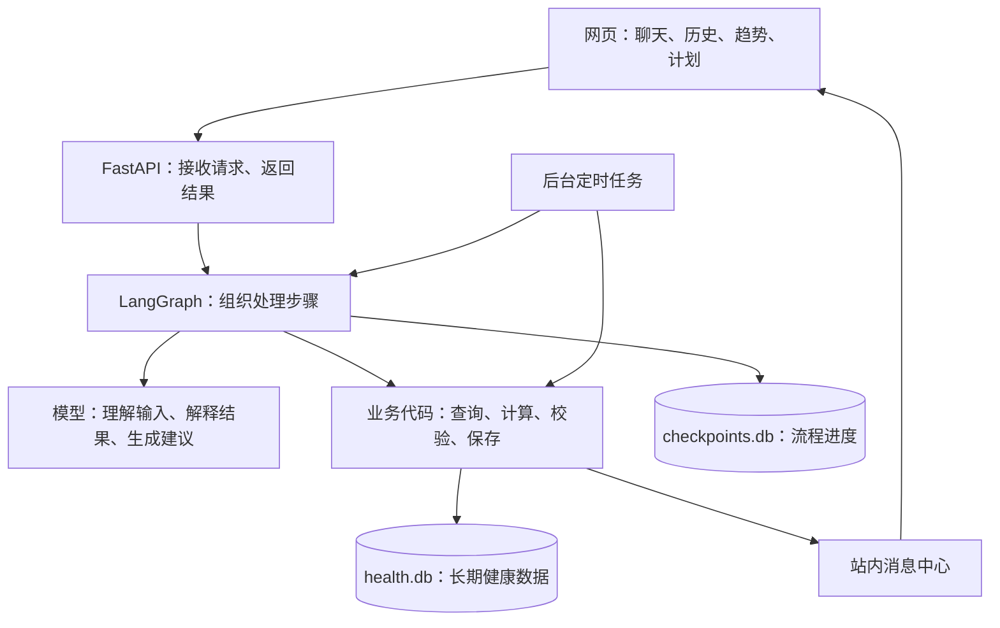
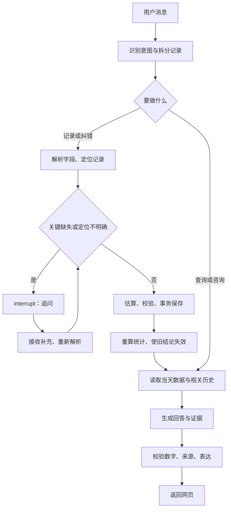
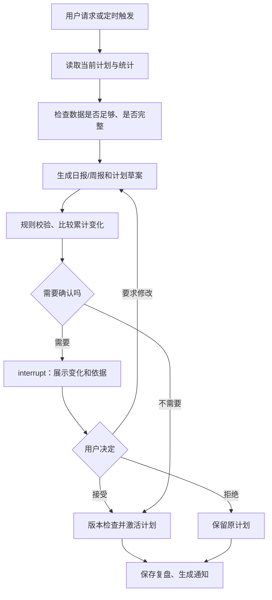

# 个人减脂 Agent 开发文档

版本：MVP v0.1 · 更新日期：2026-10-08 · 开发框架：LangGraph Python

这份文档用于指导第一版开发。产品需求来自前面的需求讨论；技术选型、权重数值和提醒时间中尚未确认的内容，会明确标为“建议默认值”。本文中的代码是流程示例，尚未实现业务功能。

## 1. 要做成什么

做一个自己使用的网页聊天 Agent。用户每天用自然语言记录饮食、体重、睡眠、运动和生理周期，系统把它们变成可查询的数据，再结合历史给出餐食建议、发现规律、调整计划。

第一版最重要的三个结果：

1. 过去记录能够准确保存、查询和修正，重启服务后也不会丢失。
2. 能发现用户认可的长期规律，说明用了哪些数据、还有哪些不确定性。
3. 次日和每周计划能执行，符合用户实际生活和过去的执行情况。

一个典型场景：

> 用户：“中午吃了一大碗牛肉面，加了一个卤蛋，汤没喝完。”
>
> Agent：记录这一餐；必要时追问一个影响较大的信息；显示估算热量、三大营养素、今天剩余额度；结合今天已吃的食物和历史，建议晚餐怎样搭配。
>
> 用户：“不是大碗，是小碗。”
>
> Agent：修改刚才的记录，重算当天数据，并更新受影响的建议。

第一版包含建档、聊天记录、历史查询、当日概览、趋势、计划、日报、周报和站内提醒。暂不包含拍照识别、语音、智能设备接入、腰围/体脂记录、多用户、注册和付费。

## 2. 已确定的交互规则

| 内容 | 第一版行为 |
| --- | --- |
| 首次建档 | 年龄、性别、身高、当前体重、目标体重、期望周期、日常活动水平 |
| 饮食记录 | 自然语言输入；只对会明显影响判断的信息追问 |
| 运动记录 | 自然语言输入；提取类型、时长、强度或主观疲劳 |
| 身体状态 | 记录体重、睡眠时长与质量、生理周期；支持补记 |
| 纠错 | 用户直接说“不是两碗，是一碗”等，系统修正对应记录 |
| 每餐反馈 | 热量与三大营养素估算、当日剩余额度、具体建议；详情可展开 |
| 餐食判断 | 综合考虑热量、营养、饱腹感、可坚持性、加餐风险和已知健康限制 |
| 权重 | Agent 给初始建议；根据历史提出调整；重要变化由用户确认 |
| 计划 | 每日热量、三大营养素、下一餐、次日重点、每周饮食和运动安排 |
| 计划调整 | 小幅变化自动生效；较大变化需确认 |
| 规律通知 | 重要规律主动提醒；一般规律放在周报，并附样本量和可信度 |
| 记忆期限 | 原始记录保留一年；更早的数据保留月度摘要 |
| 风格 | 专业、数据驱动，说明依据和不确定性 |

暂不设置首次健康安全筛查。用户主动透露的过敏、疾病或医生限制可以存为已知约束；未提供的信息标为“未知”，不能宣称已经完成健康适配。

情绪、饥饿感和餐后饱腹感不属于第一版必填记录。如果用户自愿在聊天中提及，可以作为带来源的补充信息。缺少这些数据时，不能生成“你压力大就会暴食”等个性化结论，也不能仅凭一次加餐判断暴食。

## 3. 整体技术结构

建议默认选型：Python 后端、FastAPI 接口、LangGraph 流程、React + TypeScript 前端、SQLite 数据库。它们用于单用户原型，后续需要部署或扩大用户范围时再评估迁移。



可以把 LangGraph 理解成“流程调度员”：它决定现在该解析、查询、计算，还是等待用户补充。节点里既可以调用模型，也可以执行普通代码。这种混合流程是 LangGraph 官方支持的用法。[LangGraph 概览](https://docs.langchain.com/oss/python/langgraph/overview)

职责分工：

| 模块 | 负责什么 |
| --- | --- |
| 前端 | 收集输入、显示营养卡片与证据、呈现待确认计划 |
| LangGraph | 按流程调用节点，处理分支、追问、确认和恢复 |
| 模型 | 提取结构化信息、理解纠错、解释统计、生成计划草案 |
| 业务代码 | 日期换算、营养求和、趋势统计、阈值判断、事务写入 |
| 数据库 | 保存事实、版本、推导结论、计划和通知 |
| 调度器 | 在约定时间触发日报、周报、提醒和归档任务 |

模型不能直接随意执行 SQL 或修改目标。给模型提供范围明确的查询和提案工具，由业务代码校验后执行。模型供应商和模型名称先通过配置注入，开发时再根据中文提取能力、结构化输出质量、成本和响应速度选择。

## 4. 长期记忆怎么实现

### 4.1 三类存储各司其职

| 存储 | 用途 | 本项目做法 |
| --- | --- | --- |
| 当前上下文 | 当前输入、近期聊天、待补充的记录 | 只取本次处理所需的信息 |
| LangGraph Checkpointer | 保存一次流程的状态，支持追问、确认、重启恢复 | 用磁盘上的 SQLite checkpointer |
| 业务数据库 | 跨对话保存健康事实、统计、规律、计划 | 使用 `health.db`，作为事实来源 |

LangGraph 的 checkpointer 面向单个线程；Store 面向跨线程的长期数据。官方还说明，内存型 checkpointer 会在进程重启后丢失数据。[持久化说明](https://docs.langchain.com/oss/python/langgraph/persistence)

本项目的长期数据以关系型业务表保存，便于按日期求和、纠错和追溯。第一版由节点调用 Repository 读取这些表；不必额外引入向量库或 LangGraph Store。以后需要语义搜索偏好时，可以接入 Store，但仍以业务数据库为准。

三个 ID 要区分清楚：

- `user_id`：固定为单用户 ID，例如 `local-user`。
- `conversation_id`：前端的一段聊天，负责显示聊天历史。
- `thread_id`：一次可暂停、恢复的 LangGraph 工作流，通常用 UUID。

追问和计划确认必须恢复原来的 `thread_id`。独立的记录或查询使用新线程，通过业务数据库共享历史。这样，一个等待确认的周计划不会阻塞用户继续记录午餐。

### 4.2 每次回答取哪些历史

不要把一整年的聊天全部塞进提示词。按任务检索：

- 记录一餐：档案、当天摄入、当前目标、相关已确认偏好、少量相似餐食。
- 查历史：按照用户要求的时间和类型精确查询；答案附记录日期或 ID。
- 生成计划：近期执行情况、体重和睡眠统计、运动记录、有效规律。
- 发现规律：业务代码读取指定窗口内的数据，计算后把结果交给模型解释。

普通建议可默认参考近 28 天；精确历史查询必须覆盖用户指定的范围。没有记录就回答“没有记录”，不能用月度摘要还原不存在的某一餐。

### 4.3 用户事实与模型推断分开

“我不喜欢燕麦”属于用户明确表达的偏好。“你似乎更容易坚持面食早餐”属于模型推断。两者要分别标记来源和状态。

推断必须附带证据、日期范围、数据完整度和规则版本。用户否认后，记录为已否认，后续建议不得继续引用；新数据出现时可以重新评估，但不能悄悄恢复旧结论。

## 5. 数据模型

建议用 SQLAlchemy 管理业务表，Alembic 管理表结构变更。第一版表的职责如下：

| 表 | 核心字段 | 作用 |
| --- | --- | --- |
| `user_profile` | 基础资料、目标、活动水平、时区、版本 | 当前个人档案 |
| `profile_facts` | 内容、来源、证据 ID、明确/推断、确认状态 | 偏好和补充特征 |
| `messages` | 会话 ID、角色、原文、时间、关联记录 ID | 对话展示与纠错定位 |
| `events` | 类型、发生时间、记录时间、原文、状态、当前版本 | 统一记录入口 |
| `meal_items` | 食物、分量、单位、克重估算、做法、营养范围、来源 | 一餐中的各个食物 |
| `event_revisions` | 事件 ID、版本、结构化内容、修改原因 | 追溯纠错过程 |
| `daily_metrics` | 日期、摄入汇总、体重、睡眠、运动、完整度 | 可重新计算的每日统计 |
| `insights` | 规律、证据、样本量、窗口、可信度标签、状态 | 保存可解释的规律 |
| `plans` | 周期、热量/营养目标、饮食/运动安排、依据、版本、状态 | 生效或待确认的计划 |
| `weight_configs` | 各项权重、版本、原因、确认状态 | 餐食评分配置 |
| `monthly_summaries` | 月份、统计、覆盖率、规律摘要、版本 | 超过一年后的长期摘要 |
| `notifications` | 类型、内容、触发时间、已读状态、去重键 | 站内提醒 |
| `jobs` | 类型、范围、状态、去重键、重试次数 | 持久保存后台任务 |

`events` 的类型包括 `meal`、`weight`、`sleep`、`exercise`、`cycle`。身体状态使用按类型校验的 JSON 字段：睡眠保存开始/结束或时长与主观质量，运动保存类型/时长/强度，周期保存开始/结束等事件。前端可支持用户明确标记某天饮食“已记录完整”，否则完整度为未知。

统一约定：体重存 kg，食材存 g，时长存分钟，热量存 kcal，三大营养素存 g。无法换算的“一碗”“一份”保留原单位，并另存估算依据。所有记录区分 `occurred_at` 和 `created_at`，避免把今天补记的昨天晚餐算到今天。

时区默认 `Asia/Shanghai`；数据库时间统一保存为 UTC，按用户时区归属日期。周期中的“结束时间尚未记录”不能自动填成固定日期。

## 6. LangGraph 工作流

第一版定义三个图：交互图、复盘与计划图、规律分析图。它们复用业务函数，不需要为每个步骤创建一个独立角色的 Agent。

### 6.1 交互图：记录、纠错、查询、建议



主要节点与实现方式：

| 节点 | 做什么 | 实现 |
| --- | --- | --- |
| `classify_intent` | 区分记录、纠错、查询、咨询；一条消息允许多条记录 | 模型结构化输出 |
| `parse_event` | 提取时间、食物、分量、运动等字段 | 模型 + Pydantic 校验 |
| `resolve_correction` | 找到要修改的记录和字段 | 查询代码 + 模型 |
| `clarify` | 对关键缺失或歧义追问 | `interrupt()` |
| `estimate_nutrition` | 匹配营养来源、计算估算范围 | 查询 + 计算代码 |
| `persist_event` | 新增或修正记录，创建版本 | 数据库事务 |
| `refresh_derived` | 更新汇总，标记受影响结论和草案过期 | 业务代码 |
| `retrieve_context` | 取本次需要的档案与历史 | 参数化查询 |
| `respond` | 解释数据、生成建议 | 模型 |
| `validate_response` | 检查数字、引用和不确定性是否一致 | 规则代码 |

一条消息如“昨天跑步半小时，今天早上 65 公斤，昨晚睡了 6 小时”，应该拆成三条带不同日期的记录。一个小缺失不应阻止其他独立记录保存。

追问策略：优先处理会改变餐食判断的缺失，例如“炸鸡一份”的大小；对少量调料等小误差保留估算。建议每轮只问一个最重要的问题；用户回答“不知道”时记录估算范围，或保留为待估算记录，不无限追问。

### 6.2 复盘与计划图



热量和三大营养素目标由有版本的计算策略生成，模型负责组织可执行的餐食和运动安排。策略参数、适用范围及营养依据在实现数值目标前确定；期望周期用于评估目标，不强行倒推极端热量目标。

第一份数值计划先展示供用户确认。后续判断“小幅/较大变化”使用配置规则，比较热量、营养、运动量及权重变化；具体阈值待实现时确定。还要比较自上次用户确认以来的累计变化，避免连续小调整绕过确认。

生成草案后、用户确认前，实际执行的目标保持原版本。确认时检查计划基准版本和数据版本；如果期间已有新记录或其他调整，重新生成差异，不能激活过时草案。

数据不足或饮食是否完整未知时，输出温和的观察与计划草案，不仅凭一两天体重就自动收紧目标。用户超出某天估算额度时，避免生成补偿性极端节食或惩罚性运动安排。

### 6.3 规律分析图

步骤：读取有效记录 → 计算特征 → 检查缺失和样本量 → 生成候选规律 → 复核干扰因素 → 保存证据 → 判断是否提醒。

第一版优先支持少量明确的统计模板，例如“睡眠分组与次日已记录摄入”“工作日与周末的饮食记录”“周期阶段与体重波动”“运动安排完成情况”。由代码计算组别、样本量和差异，模型把结果翻译成易懂的解释。

可信度用“数据不足 / 初步观察 / 多次重复”这类标签，同时解释覆盖率、时间范围和干扰因素。它不是模型主观给出的百分比，也不代表医疗证据等级。最小样本和窗口长度属于可配置的分析规则，需要用测试数据验证。

例如：

> “这段时间，睡眠较短的次日已记录摄入平均更高。不过两组记录较少，且周末占比不同，目前只能作为初步观察。”

必须同时显示两组样本量、日期范围、完整度和来源链接。不能表达成“少睡会让你多吃”，也不能把漏记的一天当成零摄入。体重只说明体重变化，不能直接等同于体脂变化。

重要程度由数据支持、重复程度、变化幅度和可行动性共同判断。重复规律合并通知；普通发现进入周报。数据不足时，明确说暂时没有可靠规律，而不是为了每周有内容而制造发现。

### 6.4 State 和暂停恢复示例

State 保存节点之间要传递的字段。例如下面的计划确认图：

```python
from typing import Any, TypedDict
from langgraph.graph import StateGraph, START, END
from langgraph.types import Command, interrupt

class PlanState(TypedDict):
    proposal_id: str
    changes: dict[str, Any]
    needs_confirmation: bool
    approved: bool

def decide(state: PlanState):
    if not state["needs_confirmation"]:
        return {"approved": True}
    answer = interrupt({
        "kind": "plan_confirmation",
        "proposal_id": state["proposal_id"],
        "changes": state["changes"],
    })
    # API 层应先校验 resume 数据；这里再做最小类型检查。
    if not isinstance(answer, dict) or type(answer.get("approved")) is not bool:
        raise ValueError("approved 必须是布尔值")
    return {"approved": answer["approved"]}

def approved(state: PlanState):
    # 实现时调用事务服务：检查版本、去重、激活计划。
    return {}

def rejected(state: PlanState):
    # 实现时记录拒绝结果，保留当前生效计划。
    return {}

def build_graph(checkpointer):
    builder = StateGraph(PlanState)
    builder.add_node("decide", decide)
    builder.add_node("approved", approved)
    builder.add_node("rejected", rejected)
    builder.add_edge(START, "decide")
    builder.add_conditional_edges(
        "decide",
        lambda s: "approved" if s["approved"] else "rejected",
        {"approved": "approved", "rejected": "rejected"},
    )
    builder.add_edge("approved", END)
    builder.add_edge("rejected", END)
    return builder.compile(checkpointer=checkpointer)

# graph = build_graph(已初始化的持久化 checkpointer)
# config = {"configurable": {"thread_id": "某次计划的UUID"}}
# graph.invoke(初始状态, config)
# graph.invoke(Command(resume={"approved": True}), config)
```

`interrupt()` 会暂停流程；用同一个线程和 `Command(resume=...)` 恢复。恢复时，暂停节点从头执行，因此写数据库、发送通知等操作放在后续独立节点，并设计去重。[中断与恢复](https://docs.langchain.com/oss/python/langgraph/interrupts)

正式交互图的 State 还应包括 `request_id`、`input_text`、`intent`、`event_drafts`、`record_ids`、`context_refs`、`response`。State 中只存可序列化数据，数据库连接和模型实例由运行环境提供。[Graph API](https://docs.langchain.com/oss/python/langgraph/graph-api)

## 7. 饮食估算与综合权重

### 7.1 估算来源和不确定性

营养查询按优先级使用：用户提供的包装信息 → 已校准的个人常吃餐食 → 可核查的营养数据 → 明确标注的模型粗估。

开发阶段可以用少量人工核对的常见食物数据跑通流程。真实使用前，应确定数据来源、授权方式和覆盖范围；测试用数据不能当成实际营养库。

每项估算保存分量范围、营养范围、来源和假设。例如“一碗面”先记录为碗，不把未经确认的克重当成用户事实。查不到合适数据时保存记录，显示“待估算”或低可信度粗估，不能为了补齐字段编造精确数字。

当日剩余额度由业务代码计算：生效目标减去已记录摄入；显示允许为负，并注明是否可能漏记。营养缺失的食物不能按零计算。运动消耗不默认直接抵扣饮食摄入，以免与活动水平重复计算。

### 7.2 权重建议

已知过敏、明确禁忌和医生限制作为约束优先检查；其余维度进行加权判断。建议初始权重如下，仅用于原型起点，等待用户确认：

| 维度 | 建议权重 |
| --- | --- |
| 当天热量适配 | 30% |
| 三大营养素适配 | 25% |
| 饱腹感 | 20% |
| 历史可坚持性 | 15% |
| 加餐风险 | 10% |

各维度先得到同尺度评分，再按权重汇总。缺少个人历史的维度标为“未知”，不能默认给满分；可以对有依据的维度重新归一化，但同时显示覆盖了多少原始权重，覆盖不足时不给综合分。

饱腹感可以先给基于餐食组成的一般性估计，明确它不是用户实际感受。可坚持性参考计划完成记录和用户反馈；加餐风险只在有相关记录时参与判断。

权重调整建议必须说明触发证据、新旧权重、预计影响和撤回方式。评分用于解释与比较，不代表医学结论，也不需要默认在每餐主卡片上展示。

## 8. 纠错、重新计算与一年归档

纠错定位优先使用前端关联的记录 ID，其次是最近对话中唯一明确的记录。如果“昨天那碗面”对应多条记录，先询问是哪一餐，不猜测写入。


修正事务保存新版本，同时创建重新计算任务。当天统计尽量同步更新；耗时的规律分析交给后台。重算完成前，旧结论标为过期，不继续用作当前建议依据。历史已生效计划保留版本，不直接改写过去的安排。

所有写入使用 `request_id` 或操作去重键。数据库已提交、图还没保存 checkpoint 时即使重试，也只会产生一条记录。单用户版本先采用串行写入和版本检查，处理同时打开多个页面或后台任务的情况。

归档采用用户时区下的日历一年截止日。先为完整过期月份生成并校验月度摘要，再清理对应原始记录；边界月份等到全月过期后处理。摘要保留统计数量、覆盖率、估算误差、规律及必要的分组汇总，不仅是一段文字。

超过一年后，支持月度级别查询，不能回答某天某餐的具体内容。原始逐日数据不在时，不宣称还能精确复核睡眠与次日摄入等规律；跨年度结论应说明摘要精度限制。

聊天原文、旧修订、checkpoint、调试日志和备份也可能包含原始饮食信息。归档和主动删除必须覆盖这些副本，防止主表清理后旧数据仍能被取回。建议已完成工作流的 checkpoint 保留 30 天，待确认工作流单独管理；这是技术默认值。

删除记录后，同步处理它的证据引用和派生结论。删除操作不在日志中保留被删除的正文。归档先验证摘要可读取、统计一致，再执行清理；任何一步失败都保留原始数据。

## 9. 网页与接口

第一版四个主要页面即可：

| 页面 | 显示内容 |
| --- | --- |
| 聊天与今日概览 | 输入框、回复、每餐卡片、已记录摄入、剩余额度、待追问 |
| 历史与趋势 | 按日期查询记录，展示体重/睡眠/运动趋势，支持对话纠错 |
| 计划与复盘 | 当前计划、次日安排、日报/周报、待确认的变化 |
| 设置与消息 | 基础资料、提醒时间、权重、消息中心、数据管理 |

建议接口：

| 方法与路径 | 用途 |
| --- | --- |
| `GET /api/profile`、`PUT /api/profile` | 查看和更新档案 |
| `POST /api/chat` | 新消息，创建工作流 |
| `POST /api/workflows/{thread_id}/resume` | 提交补充或确认，恢复工作流 |
| `GET /api/workflows/{thread_id}` | 查询处理状态或待回答问题 |
| `GET /api/events` | 按日期、类型、食物等条件查历史 |
| `DELETE /api/events/{event_id}` | 主动删除指定记录 |
| `GET /api/dashboard?date=...` | 获取当天汇总与完整度 |
| `GET /api/plans`、`GET /api/reviews`、`GET /api/insights` | 计划、复盘、规律 |
| `GET /api/notifications`、`PATCH /api/notifications/{id}` | 通知列表和已读状态 |
| `GET /api/data/export` | 导出当前可保留的数据 |

新消息包含 `request_id`、`conversation_id`、`text`。返回包含 `thread_id`、`status`、`reply`、`cards`、`evidence_refs` 和可选 `pending_input`。状态至少区分 `running`、`waiting_input`、`completed`、`failed`。

补充接口校验 `interrupt_id`、字段格式和任务状态，防止重复确认或恢复错误线程。用户对追问说“先不记了”时，应取消草案；提出新的独立问题时，可创建新线程而保留待处理事项。

建议先实现普通 JSON 请求和任务状态查询，再增加 SSE，显示“正在解析”“正在查询历史”等进度。营养数字卡片直接使用服务端计算结果，避免模型文字与卡片不一致；不将完整内部 State 原样暴露给前端。

## 10. 主动提醒与后台任务

提醒默认时间尚未确认。设置页提供餐点、称重、睡眠记录、每日总结和周复盘时间，用户随时可关闭、延后或标记跳过。

| 任务 | 触发与去重规则 |
| --- | --- |
| 漏记饮食 | 到约定时间仍无对应记录；当天同餐最多一次，已跳过不再提醒 |
| 下一餐建议 | 餐前生成；读取最新摄入和计划，已有新餐记录时不再发送旧建议 |
| 身体/运动记录 | 按用户设置提醒；运动只提醒约定活动，周期不按固定周期强行推算 |
| 日报 | 每日生成一份，明确已记录内容和缺失项；补记后可更新版本 |
| 周报与下周计划 | 每周生成；较大调整进入待确认，不自动替换当前计划 |
| 规律分析 | 每日或周报前触发；修正记录后按需重跑 |
| 月度归档 | 定期检查完整过期月份，完成摘要验证后清理 |

调度器可以采用 APScheduler 或独立定时入口；业务任务必须先保存到 `jobs` 表，服务重启后处理未完成任务，避免只依赖内存计时器。每类任务用日期、类型和版本组成去重键。

第一版提醒放进站内消息中心，网页打开时显示；网页关闭时，后台继续运行才能生成消息，用户下次打开能看到。要在关闭网页时仍实时收到通知，需要额外接 Web Push 等渠道，暂作为后续扩展。服务器未运行期间的旧餐前提醒不补发，日报和周报可按需补生成。

## 11. 建议代码目录与开发顺序

```text
health-management/
├─ docs/开发文档.md
├─ backend/
│  ├─ app/
│  │  ├─ main.py                # API 入口
│  │  ├─ api/                   # 聊天、历史、计划接口
│  │  ├─ graphs/                # 三个 LangGraph 工作流
│  │  ├─ nodes/                 # 解析、追问、回答等节点
│  │  ├─ schemas/               # 输入输出与模型提取格式
│  │  ├─ repositories/          # 数据库读写
│  │  ├─ services/              # 营养计算、纠错、计划、统计
│  │  ├─ prompts/               # 提示词及版本
│  │  ├─ jobs/                  # 提醒、复盘、归档
│  │  └─ config.py              # 模型、阈值、时区等配置
│  ├─ migrations/
│  └─ tests/
├─ frontend/src/
├─ data/                        # 本地数据库；不提交到 Git
└─ .env.example                 # 只列配置名，不包含真实密钥
```

依赖建议包括 `langgraph`、`langgraph-checkpoint-sqlite`、`fastapi`、`uvicorn`、`pydantic`、`sqlalchemy`、`alembic`、`pytest`，另加所选模型适配包和调度器。开始实现时安装验证并锁定版本，避免依赖自动升级改变暂停恢复行为。

按以下顺序交付，每阶段都能实际试用：

| 阶段 | 开发内容 | 完成条件 |
| --- | --- | --- |
| 1. 数据底座 | 档案、事件、修订、聊天 API、SQLite 持久化 | 五类数据能保存、跨天补记、重启后查询 |
| 2. 对话记录 | 结构化解析、关键追问、自然语言纠错、营养来源 | 吃一餐→追问→保存→修正→重算全链路可用 |
| 3. 历史判断 | 按任务检索、今日概览、下一餐建议、证据引用 | 建议能说明参考了哪些个人记录 |
| 4. 动态计划 | 日/周计划、权重版本、变化比较、中断确认 | 小调整按规则生效；大调整可接受、修改或拒绝 |
| 5. 长期服务 | 统计模板、规律、日报/周报、提醒、归档 | 模拟多周数据验证后，开始四周真实试用 |

先把“记录—纠错—查询”做可靠，再完善个性化分析。第一版可以用固定规则和明确的分析模板实现权重学习，不需要在线训练模型。

## 12. 验证与四周试用

开发测试集中在容易产生错误的地方：

- 同一个请求重试，只新增一次；同一记录纠错后汇总不重复累加。
- “昨晚”“今天早上”等日期按上海时区归属，补记和跨午夜睡眠正确。
- 多条记录一起输入、分量未知、纠错对象不唯一时，能正确拆分或追问。
- 服务在追问或确认时重启，能够恢复；节点重放不重复写入或通知。
- 计划拒绝后目标不变；确认过时草案会触发重新比较；累计变化不能绕过确认。
- 漏记和未知营养不算零；证据不足时不生成高可信度规律。
- 修正或删除记录后，受影响结论失效；归档后无法取回逐餐原文。
- 定时任务重试、浏览器关闭和服务重启后，提醒不会重复或错误补发。

使用合成数据和人工核对数据验证流程，不把合成规律当成真实发现。模型提取用一组固定中文输入做回归检查；营养数值误差单独评估，因为流程可靠不代表估算精确。

四周试用的验收建议：

| 用户关心的结果 | 怎么验收 |
| --- | --- |
| 历史准确 | 抽查至少 20 条真实记录，确认时间、内容、修正结果和查询引用一致 |
| 规律有价值 | 每个发现都能追溯证据，用户可标记认可/不认可；数据不足时如实报告 |
| 计划能执行 | 用户每周评价安排是否适合实际生活，记录未完成原因，观察后续计划是否改进 |

“发现至少一些认可的规律”是目标，不是强制产出配额。若四周数据仍不足，应指出缺少哪类记录或观察时间，而不是提高措辞确定性。

原型建议先只监听本机。若以后部署到可远程访问的环境，即使单用户也要加访问保护；模型密钥只放后端配置。发送给模型的健康记录应限于当前任务需要的内容，调试默认不上传完整原文。

开发前仍需落实的配置项：模型供应商、营养数据来源、数值目标计算策略及依据、小幅/重大变化阈值、提醒时间、可信度规则。它们不影响先完成数据底座，但要在相应功能启用前明确并保存版本。

本文框架接口依据官方 LangGraph 文档核对，核对日期为 2026-10-08；示例用于说明流程，实际实现仍需锁定依赖并验证持久化与恢复。
