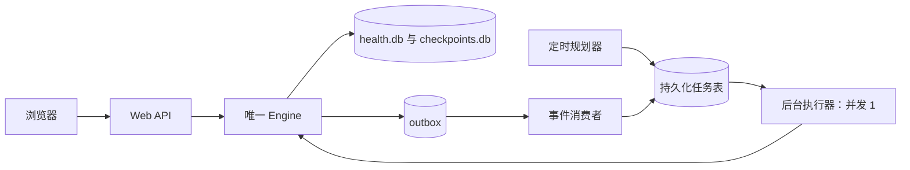
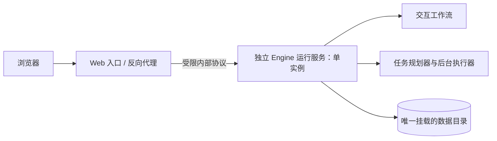
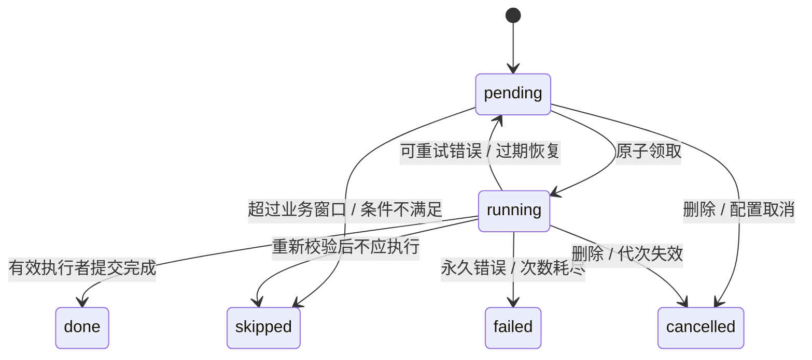

# 调度器可靠性与独立 Worker 开发方案

日期：2026-10-27  
状态：A 期代码已实施，Windows 本地全量后端回归通过；B/C 期未实施，Linux/容器专项部署验收未运行。项目仍只允许每个数据目录一个 Engine。  
对应问题：[架构与安全 Review 建议](架构与安全Review建议.md)第 7.1 节。

## 1. 开发结论

采用“持久化任务表 + 原子领取 + 有期限的执行权 + 幂等业务结果”的方案，先修复可靠性，再拆进程。当前单用户、低频任务不立即引入 Redis、RabbitMQ 或 Celery。

本项目的进程拆分存在一个必须先处理的约束：Web 请求和定时任务都使用 `Engine`，而工作流锁、`context_epoch`、checkpoint 保护及启动恢复仍依赖单个 Engine 的运行环境。不能仅把 `tick()` 搬到另一个进程，让两个 Engine 同时使用现有数据库，就宣布支持多进程。

推荐分两期交付：

| 阶段 | 交付内容 | 部署边界 |
| --- | --- | --- |
| A：本期必须完成 | 规划与执行分离、持久化任务、租约、重试、幂等、事务与 outbox、删除保护、故障测试 | 仍只有一个 Engine 所有者；Web 与后台执行器同进程 |
| B：需要进程隔离时完成 | 将整个 Engine 运行服务移到独立进程，Web 入口通过内部协议调用它 | Web 入口不打开业务库或 checkpoint 库；Engine 运行服务仍单实例 |
| C：未来扩容 | 共享数据库、分布式工作流协调、成熟消息队列和多个执行 worker | 另行设计与验收，A/B 完成不意味着 C 完成 |

“独立 worker”在 B 期指独立的业务运行进程，同时承接交互工作流和后台任务。保留同一个 Engine 的协调边界，是本项目对常见后台任务架构的具体适配。

## 2. 业界做法与选型依据

### 2.1 通用处理方式

1. 调度器只判断时间和生成待办，执行器领取并运行任务。
2. 任务和重试状态持久化，进程退出后由下一次运行恢复。
3. 单个调度领导者或唯一任务键控制重复派发；原子领取控制执行权。
4. 允许失败后重试，通过幂等键保证重复处理不产生重复业务效果。
5. 业务提交后需要触发其他动作时，将业务结果与 outbox 事件一起提交。

例如 Celery Beat 负责派发周期任务，worker 负责执行。官方要求同一份日程只有一个 Beat 调度器，并说明任务可能重叠，需要额外协调。[Celery 周期任务文档](https://docs.celeryq.dev/en/stable/userguide/periodic-tasks.html)

Celery 的确认时机、worker 丢失处理和业务幂等需要显式设计；使用任务框架不会自动获得“业务只执行一次”。[Celery 任务文档](https://docs.celeryq.dev/en/stable/userguide/tasks.html)

### 2.2 本项目选择

| 方案 | 优点 | 本项目结论 |
| --- | --- | --- |
| 只拆一个循环进程 | 改动少 | 不充分，任务所有权及 Engine 跨进程协调仍未解决 |
| SQLite 持久化任务表 | 复用现有数据库，部署简单 | A/B 期采用，限制为单机本地磁盘、一个 Engine 所有者 |
| Celery + 消息代理 | 提供成熟的分发、重试与运维能力 | 任务量、并发及运维需要增长后评估 |
| 系统计划任务或容器 CronJob | 适合固定时间启动批任务 | 可以作为外部触发入口，不能替代业务去重和恢复 |

SQLite 支持不同连接的并发读取，但只有一个同时进行的写事务。写事务互斥不等于任务在整个执行期间独占；执行权仍由条件更新和租约控制。[SQLite 事务文档](https://www.sqlite.org/lang_transaction.html)

## 3. 当前实现与问题证据

以下路径以本文编写时的工作区为准。表内以 `backend/` 开头的路径相对仓库根目录，其余代码路径以 `backend/app/` 为前缀。

| 文件/对象 | 当前行为 | 开发时需解决的问题 |
| --- | --- | --- |
| `backend/app/main.py` | lifespan 按 `scheduler_enabled` 启动循环 | 每个应用实例都可能启动调度；没有数据目录单所有者约束 |
| `backend/app/jobs/scheduler.py` | 一个 tick 同时判断到期、归档、生成日报/周报、通知、生成计划 | 触发与执行耦合；一次长任务会推迟后续扫描 |
| `repositories/maintenance.py` | `start_job()` 只排除 done 和次数耗尽 | running 可被再次领取；完成更新不验证执行权 |
| `infrastructure/database.py` | jobs 只有 key、kind、status、attempts、created_at | 无租约、执行者、执行历史、失败分类和下次重试时间 |
| `repositories/planning.py` | 通知有唯一 dedupe_key，报告按固定 ID 保存 | 能约束部分重复行，不能约束整个任务的执行过程 |
| `workflows/runtime.py` | request ID、checkpoint 支持工作流重放 | 同进程锁与业务恢复不能直接扩展为跨进程执行租约 |
| `privacy/deletion.py` | `_reset_job()` 重置旧 jobs 并递增 job_generations | 新任务与 outbox 必须纳入删除和代次失效规则 |
| `common/execution_budget.py` | tick 参与 RuntimeLimiter；硬期限可能使加固进程退出 | 长任务及心跳不能绕过现有限额；必须能恢复被中断的执行 |

已在隔离临时数据库中，用两个独立 Repository 连接复现：A 领取后 B 仍能领取；A 标记 done 后，B 的失败更新将其改回 pending。该验证证明现有状态协议有缺口，不是完整的多进程负载测试。

其他需要处理的故障：

- 重复领取消耗重试次数；第三次执行崩溃后可能留下无法再次领取的 running。
- 日报、通知和 job 完成分别提交，崩溃后会出现部分完成。
- 周报已生成但计划生成失败，会让一个粗粒度 weekly job 同时表示多个不同结果。
- 当前周期扫描只在指定当天触发周任务，停机跨过该日后缺少明确补跑策略。
- 当前回补日报路径不发送当日日报通知；迁移时不能把所有历史报告当成新通知发送。

## 4. 目标架构与交付范围

### 4.1 A 期：可靠执行，保留单 Engine



上述组件是逻辑角色，A 期都由现有应用进程管理。定时规划器不执行报告或模型调用；每个任务独立申请执行额度，避免整个扫描批次共享一个执行期限。

新增数据目录所有者锁：在构造 Engine、运行迁移及任何启动恢复之前，独占持有 `DATA_DIR` 下的固定锁文件。使用支持 Windows/Linux 的 OS 文件锁，进程退出由操作系统释放，不能靠 PID 文本或“锁文件存在”判断。

同一目录的第二个 Engine 启动必须失败，错误码 `data_directory_in_use`。锁覆盖进程整个生命周期，开发模式和加固模式均生效；`--reload`、多 worker、多个容器同时打开同一数据目录不属于受支持部署。锁文件不删除后重新创建，避免不同进程锁住不同 inode。

### 4.2 B 期：独立 Engine 运行服务



B 期优先复用现有受限网关转发 HTTP：所有数据 API、删除、恢复和后台运行都留在 Engine 服务；入口只承担静态文件、代理及入站限制。如果保留 Python Web 门面，它不能自行构造 Engine、Repository 或读取 checkpoint。

Engine 服务不发布公网端口；入口只代理固定上游，不允许客户端选择内部 URL。开发环境仅监听回环地址；加固环境延续内部网络、模型受控出口、非 root 与秘密文件约束。所有者锁继续生效。

B 期提高进程边界清晰度，不承诺运行服务崩溃时交互请求仍可成功，也不承诺水平扩容。容器、网关和进程监督需沿用[运行环境最小权限修复方案](运行环境最小权限修复开发方案.md)，不得为拆分放宽权限。

### 4.3 本期业务范围

覆盖归档、上下文清理、日报、周报、餐前提醒、漏记提醒、身体状态提醒、自动计划生成。保留既有营养、安全分类、模型数据边界和计划确认规则；不新增邮件、短信或推送渠道。

## 5. 任务模型、时间和补跑

### 5.1 任务身份

新增 `scheduled_jobs`，不直接扩展旧表的五列位置式 INSERT。唯一业务身份为 `(logical_key, generation)`。

| 类型 | logical_key 示例 | 到期与失效规则 |
| --- | --- | --- |
| archive | `archive:2026-10-27` | 当日维护，失败独立重试 |
| daily | `daily:2026-10-26` | 日结或历史补算，目标日期固定 |
| weekly | `weekly:2026-10-25` | 以配置的周复盘日期作为 period_end |
| next_meal | `next:2026-10-27:lunch` | 只在餐前提醒窗口内有效 |
| missing_meal | `missing:2026-10-27:lunch` | 只在漏记提醒窗口内有效，执行前重新查记录 |
| checkin | `checkin:2026-10-27` | 到配置时间触发，过当天失效 |
| auto_plan | `auto-plan:weekly:2026-10-25` | 由周报完成事件创建，执行前检查有效目标 |

generation 延续 `job_generations` 的业务含义：删除或失效后允许生成新一代产物。它不是每次重试的编号，也不是租约凭证。普通重试保留同一 generation、任务 ID 和工作流 request ID。

### 5.2 时间与窗口

- 业务日期按 `Asia/Shanghai` 计算；数据库调度时间、租约时间统一存 UTC epoch 毫秒整数，避免混用 ISO 字符串排序。
- 领取与续租以数据库获取的当前 UTC 时间判断。执行总期限继续用 monotonic 时钟；两者用途不同。
- 规划器默认每 60 秒扫描，执行器每 2 秒扫描已到期任务。重复扫描只尝试插入唯一任务，不重复生成业务结果。
- 日报回补保留“最近 7 天有记录才生成”的规则；历史补算不追加普通日报通知。
- 周报默认补跑最近 7 天内错过的配置周复盘日期；更久的任务记录为跳过，不无限补历史。空数据仍沿用现有完整性说明。
- 历史周报可补算，自动计划只允许基于尚未跨过下一个周复盘日的最新周报触发；同一时刻只为最新有效周期创建计划任务。
- 餐前提醒和漏记提醒不跨有效窗口补发；checkin、当日日结通知不跨业务日补发。过期任务进入 skipped。
- 配置更新后重新计算尚未执行的提醒，取消旧时间安排；已发提醒不因配置变更重复发送。领取后执行前再校验偏好和窗口。
- `notifications_enabled=false` 时不创建或发送用户提醒，已排队提醒取消；归档、日报和周报计算继续。本期明确调整当前“周报和当日日报受通知开关短路”的行为，报告计算与消息提醒分开验收。

### 5.3 固定业务时间

领取时不能用新的 `now()` 替代原任务的 `period_end`。日报/周报显式传目标日期；计划新增固定 `schedule_anchor`，避免跨午夜重试后生成不同日期的安排。

`reference` 测试参数必须传入规划、报告和计划逻辑，不只影响外层 key。旧 `build_analysis()` 未向 `review()` 传固定结束日期，需要一起修复。

## 6. 持久化结构与状态机

### 6.1 scheduled_jobs

| 字段 | 含义 |
| --- | --- |
| id / logical_key / generation / kind | 固定任务身份；唯一约束 `(logical_key, generation)` |
| payload / payload_version | 白名单参数：目标日期、餐次、来源产物 ID 等，禁止任意 SQL、URL、健康原文 |
| processing_mode | 固定隐私限制；重试只能收紧，不得将 local_only 放宽 |
| status | pending / running / done / failed / skipped / cancelled |
| scheduled_at / next_attempt_at / expires_at | 原定到期、下次可领取、业务有效窗口结束时间 |
| attempts / max_attempts | 实际领取执行次数，默认最多 3 次 |
| lease_token / lease_until / worker_id | 每次领取的新随机凭证、租约截止、诊断用执行者 ID |
| created_at / started_at / heartbeat_at / finished_at | 创建、最近一次开始、最近心跳及终态时间 |
| result_ref / outcome_code | 产物引用和业务结果，例如 waiting_confirmation |
| error_category / error_code | 脱敏失败分类与固定错误码 |

对 `(status, next_attempt_at)`、`(status, lease_until)` 建索引，状态和非负次数有 CHECK 约束。

新增 `job_attempts`，保存每次领取的 attempt_no、开始/心跳/结束时间、结果、错误分类；唯一约束 `(job_id, attempt_no)`。重试不能覆盖历史。lease_token 不写普通日志。

### 6.2 状态流转



终态不能被普通失败处理改回 pending。人工重试仅针对 failed：记录操作及原因、重新验证窗口和删除标记、增加允许尝试次数，再恢复为 pending；不能为了重试随意增加业务 generation。

## 7. 原子领取、心跳与过期执行隔离

### 7.1 领取协议

先取得本地后台并发位和 RuntimeLimiter 工作额度，再领取一条任务。未获得额度属于背压，不增加 attempts。

领取使用显式短事务；下例是协议示意，不是可直接复制的迁移脚本：

```sql
BEGIN IMMEDIATE;
-- 在同一事务中先处理业务失效、generation 失效及过期租约。
-- 选出一条 pending 且 next_attempt_at <= 数据库当前时间的任务。
UPDATE scheduled_jobs
SET status = 'running', lease_token = :new_token,
    worker_id = :worker_id, attempts = attempts + 1,
    started_at = :db_now, heartbeat_at = :db_now,
    lease_until = :db_now + :lease_ms
WHERE id = :job_id AND status = 'pending'
  AND next_attempt_at <= :db_now AND attempts < max_attempts
  AND (expires_at IS NULL OR expires_at > :db_now);
-- 只有 rowcount == 1 才写 job_attempts 并返回 JobLease。
COMMIT;
```

同事务检查任务 generation 是否仍为当前业务代次，并检查相关删除任务及 tombstone。数据库忙时有界退避，不长时间阻塞交互请求。

### 7.2 心跳与续租

建议默认：租约 90 秒，心跳 20 秒；这是工程初始值，需通过故障注入验证后调整。它们不代替现有单轮执行总期限。

续租条件必须包含 id、status=running、generation、lease_token 匹配和原租约尚未过期；已过期的执行者不能自己续租复活。续租影响零行即失去执行权，停止后续动作。

心跳使用独立 SQLite 连接和短事务，不能在模型调用时被同一共享连接阻塞；不单独占用一个用户工作执行额度。它必须关联仍活跃且未超期限的执行上下文，不能在任务超期或取消后无限续租。

### 7.3 回收与写回约束

租约过期后，恢复器在短事务内结束旧 attempt，撤销 token，按重试次数和业务窗口转为 pending、failed 或 skipped。恢复和领取可以由同一个扫描器完成。

成功、失败、每个业务写入节点及 workflow/checkpoint 提交前均校验 JobLease；不能只在最后 `finish_job()` 时校验。health.db 的校验与相关写入置于同一事务，避免“先检查有效，随后已被接管仍写入”。

对于 checkpoints.db，跨库原子提交无法由 health.db 的事务保证。A/B 期通过唯一 Engine 所有者、同一工作流执行锁和节点提交检查串行化本地接管；新 attempt 必须等旧执行离开工作流临界区。旧线程无法退出时不并发接管，交由既有硬期限监督终止进程，重启后恢复。

租约只能保护受校验的动作。已经发出的模型请求无法撤回；模型可能已计费但响应尚未持久化时，恢复可能再次调用。保留现有预算和已保存结果复用，不宣称模型调用恰好一次。

## 8. 业务幂等、事务与 outbox

### 8.1 事务边界

当前 Repository 多个方法各自使用 `with self.conn`。外层再包一层同样的上下文，不能视为真正的嵌套原子事务；内层可能提前提交。

新增明确的 Unit of Work：顶层管理 BEGIN/COMMIT/ROLLBACK，内部仓储写入使用同一连接且不自行提交，必要时使用 SAVEPOINT。禁止对模型调用持有数据库写事务或全局 Engine 锁。

| 动作 | 同一 health.db 事务中提交 |
| --- | --- |
| 本地日报 | 报告及血缘、有效期内的站内通知、任务 done 和 attempt 成功 |
| 周报完成收尾 | 已持久化周报/工作流产物的验证、站内通知、下游计划 outbox、任务 done |
| 消费生成计划事件 | 唯一 auto_plan 子任务、outbox consumed |
| 删除/失效 | 既有业务删除状态、代次提升、关联任务和未消费 outbox 撤销 |

周报的分析节点、checkpoint 和报告仍可能先于收尾事务提交。恢复时通过稳定 request ID 复用或继续原工作流，再做幂等收尾；不能声称整个 LangGraph 图和两个数据库被一个事务覆盖。

### 8.2 结果去重

- 同任务同代次重试使用固定 request ID，例如沿用 `weekly:{day}:generation:{generation}`，不能把 attempt_no 拼入 ID。
- 日报和周报产物沿用 period/date 身份；重算必须验证数据血缘与当前代次，旧结果不能覆盖新代次结果。
- 通知继续使用唯一业务 dedupe_key。删除后重建的允许行为由 generation 和删除策略决定，不靠随机通知 ID 去重。
- 计划使用固定 request ID、固定 anchor 和现有 `save_plan()` 的 op_key；沿用目标变化确认及过时草案检查。
- 计划工作流返回 waiting_input，表示草案已交给用户确认：auto_plan 任务可标 done，outcome_code=waiting_confirmation，不能一直 running 或自动替用户确认。
- 计划被安全策略拦截或业务条件不满足，记录明确业务结果，不能当作瞬时异常反复尝试。

### 8.3 outbox 设计

新增 `outbox_events`：id、event_key UNIQUE、event_type、source_job_id、generation、payload、status、attempts、next_attempt_at、lease_token、lease_until、created_at、consumed_at、error_category/code。领取与重试复用第 7 节协议；另建 `outbox_attempts` 保存按 event_id 关联的消费历史，不能混用仅关联 job_id 的 job_attempts。

本期事件白名单为 `weekly_review_ready`，payload 只放来源 ID、业务日期、generation、base_plan_id、固定计划 anchor 和 processing_mode。消费者创建 auto_plan 子任务，不能执行来自 payload 的函数名、URL 或自由文本。

周报收尾事务生成事件时记录“当时已有有效计划、允许派生计划”的意图；消费与执行时再次检查当前目标及安全条件。当前生效计划已不同于 base_plan_id 时，旧事件或子任务 skipped，不覆盖用户后续操作。周报后新建的第一份计划不会因旧周报事件被意外再生成。

站内通知本身就在 health.db，直接与本地结果原子提交即可，不为每条通知强制绕一遍 outbox。未来新增邮件、短信或推送时，再增加对应事件消费者；发送前检查来源和隐私限制，成功后记录回执。

outbox 解决业务提交与后续事件之间的漏记问题；它可能重复投递，消费者仍需幂等。不能把 outbox 等同于外部副作用恰好一次。[AWS Transactional Outbox 指南](https://docs.aws.amazon.com/prescriptive-guidance/latest/cloud-design-patterns/transactional-outbox.html)

## 9. 删除、隐私与资源限制

1. 扩展现有删除 manifest/血缘处理，将任务参数引用、outbox 引用纳入依赖清单。用户删除记录后，未消费事件不能保留被删健康内容副本。
2. `_reset_job()` 改为同事务提升 job_generations、撤销旧任务租约、取消旧代次 outbox 和子任务，再按需要创建新代次任务。新代次不能自动复活已删除请求。
3. 事件消费及任务执行都重新验证 generation、来源生命周期、tombstone、删除 fence 和保留期限；引用已删或已失效时 cancelled，不当作网络失败重试。
4. processing_mode 随任务、事件、工作流持久化；服务器 local_only 与任务限制取更严格者，重启后不能放宽。延续 ModelBoundary 的授权、调用次数、字节预算和供应商限制。
5. 日志只写任务 ID、类型、attempt、耗时和固定错误码，不写餐食原文、健康数据、模型响应、密钥、完整异常字符串或数据库导出。
6. 后台并发默认 1，并限制不超过工作额度；超过 1 个工作额度时为交互预留至少 1 个。只有 1 个额度时标明后台可能短暂占用，准入失败延后领取。
7. RuntimeLimiter 到期后不在已失效的 execution budget 内强行更新数据库；由新一轮受限恢复操作或重启后的租约恢复收尾。取消 to_thread 的等待不等于线程已经退出。
8. 默认任务/attempt 元数据保留 30 天；已处理 outbox 去除 payload 后保留最小去重标识。仍处于 7 天补跑窗口或被工作流引用的身份不得清理；隐私删除优先，必要去重标记不得包含健康原文。

## 10. 错误分类和重试

| 分类 | 例子 | 处理 |
| --- | --- | --- |
| transient | 上游临时不可用、可恢复网络故障 | 默认最多 3 次，首次失败后 60 秒、第二次后 300 秒，加少量随机抖动 |
| storage_busy | SQLite 短时忙 | 领取事务短退避；未领取不消耗 attempt，执行后错误按有界策略处理 |
| runtime_timeout | 执行总期限到期、进程被监督回收 | 撤销旧 attempt 后恢复，仍受次数和业务窗口限制 |
| permanent | 参数版本不支持、固定配置错误 | failed，等待修复与人工重试 |
| obsolete | 业务窗口过期、当前没有有效计划 | skipped，记录具体 outcome |
| privacy_cancelled | 删除、来源失效、generation 改变 | cancelled，禁止自动重试 |
| lease_lost | token 不匹配或租约已过期 | 旧执行者退出，不调用普通失败更新 |
| business_blocked | 安全策略拦截、需要用户确认 | 保存业务结果，不用技术重试绕过业务限制 |

网络及模型错误的可重试性沿用现有异常类型，不能简单按所有 Exception 重试。已提交的独立结果保留；只补做缺失步骤，不重新创建已完成产物。

## 11. 配置、生命周期与运维

新增配置均为拟议项，尚不可用于现有启动命令：

| 配置 | 建议默认值 | 说明 |
| --- | --- | --- |
| `SCHEDULER_ENABLED` | 保留现有默认 true | 是否生成新的周期任务 |
| `JOB_RUNNER_ENABLED` | true | 是否领取执行已存在任务；维护时可单独停止 |
| `JOB_POLL_SECONDS` | 2 | 执行器扫描频率 |
| `JOB_LEASE_SECONDS` / `JOB_HEARTBEAT_SECONDS` | 90 / 20 | 校验 heartbeat 小于 lease 的三分之一 |
| `JOB_MAX_ATTEMPTS` | 3 | 领取执行次数上限 |
| `JOB_SHUTDOWN_GRACE_SECONDS` | 15 | 停止领取后的最大排空等待 |
| `JOB_CATCHUP_DAYS` | 7 | 日报/周报回补窗口上限 |

启动顺序：配置验证 → 数据目录所有者锁 → 离线迁移 → Engine/既有删除恢复 → 任务恢复 → 启动限额监督、执行器及规划器 → 就绪。

关机顺序：停止规划和新领取 → 停止事件消费 → 通知执行上下文停止 → 等待正在执行的节点安全退出 → 完成或保留可回收租约 → 关闭数据库 → 释放所有者锁。线程未退出时不能先关闭它仍可能使用的连接；加固模式超过宽限由既有监督回收整个进程。

运维至少提供：pending 数、running 数、失败数、最老到期延迟、最后一次规划时间、租约恢复次数、outbox 积压及后台执行耗时。错误码包括 `job_lease_lost`、`job_attempts_exhausted`、`job_payload_unsupported`；对外响应按既有错误响应策略脱敏。

人工查看、暂停与重试先采用本机管理命令，不新增公网管理接口。CLI 不得与运行中的 Engine 竞争数据库：在线操作通过所有者服务，离线操作先获取同一目录锁。

## 12. 迁移、发布与回滚

1. 停止旧服务，确认退出；完整备份 health.db、checkpoints.db 及必要 WAL 状态，记录 schema 版本。不能只在运行中复制两个主文件作为一致备份。
2. 在数据目录锁内执行版本化迁移，新建 scheduled_jobs、job_attempts、outbox_events、outbox_attempts。实现迁移事务，避免现有 executescript 使用方式造成隐式提前提交。
3. 旧 jobs 保留只读。done 导入 done；pending 在次数未耗尽且窗口有效时导入 pending；次数耗尽导入 failed；历史窗口已过则 skipped。
4. 旧 running 没有真实租约，只能在确认旧进程停止的离线迁移中恢复。导入前记录 legacy_interrupted；有效且未耗尽可重试，否则 failed/skipped。新表不得把 attempts>=3 的旧 running 静默保留为可执行。
5. generation 从现有 job_generations 导入，默认 0；复用现有工作流 request ID 规则。旧 weekly 标为 done 但没有足够历史信息判断下游是否完成时，不自动补发通知或创建计划，只报告人工核查项。
6. 一次只运行旧循环或新任务执行器，不能双跑。生产升级后先验证恢复与通知去重，再开放正常扫描。
7. 新 schema 提升 user_version，旧版本程序应拒绝打开；回滚必须停服并恢复成对数据库备份。恢复会丢弃备份后的写入，不能承诺无损降级。

## 13. 文件级开发任务

以下新增路径是计划，不表示文件已存在。

| 任务 | 文件范围 | 完成标准 |
| --- | --- | --- |
| T1：所有者与结构迁移 | `infrastructure/database.py`；新增 `infrastructure/data_owner.py`、`repositories/jobs.py` | 锁在 Engine 构造前生效；迁移幂等、失败不半迁移；旧数据转换可审计 |
| T2：事务和领取协议 | 新增 `infrastructure/unit_of_work.py`；jobs 仓储；调整 `repositories/planning.py`、`maintenance.py` | 原子领取、心跳、终态更新、attempt 历史及同事务提交通过测试 |
| T3：规划与执行分离 | 拆分 `jobs/scheduler.py`；新增 `jobs/planner.py`、`runner.py`、`handlers.py` | 所有现有定时动作入队；每任务独立额度、固定日期、背压不消耗次数 |
| T4：工作流执行保护 | `workflows/runtime.py`、`concurrency.py`、`planning.py`；`health/analysis.py`、`health/planning.py` | JobLease 进入节点与 checkpoint 校验；重放复用；固定 period_end/anchor |
| T5：outbox 与子任务 | 新增 `repositories/outbox.py`、`jobs/outbox.py`；周报收尾逻辑 | 报告与事件意图一致；消费和创建子任务原子；计划确认语义保持 |
| T6：删除与恢复 | `privacy/deletion.py`；`workflows/engine.py`、`runtime.py` | manifest 覆盖新增引用；旧代次工作不能恢复被删内容 |
| T7：配置与部署 | `common/config.py`、`main.py`、`.env.example`、`start.ps1`、Compose/监督脚本 | 启停顺序、参数校验、目录锁、健康状态和运维命令可用 |
| T8：故障测试与说明 | 新增任务相关测试；调整现有测试；README 与部署说明 | 第 14 节场景及既有相关回归通过，交付 A 期证据 |
| T9：独立运行服务（B 期） | 网关/内部协议、启动入口和部署配置 | 所有数据 API 统一路由唯一 Engine；入口不持有数据库及模型秘密 |

T1/T2 是后续任务前置；T4/T5/T6 不能跳过直接发布独立执行器。T9 单独交付，不作为 A 期可靠性修复必须同时实施的范围。

## 14. 验收场景与通过条件

| 编号 | 场景 | 必须观察到的结果 |
| --- | --- | --- |
| AC-01 | 重复扫描同一日期/餐次 | 同 logical_key、generation 只有一条任务 |
| AC-02 | 两独立进程同时领取测试任务库 | 只有一个领取成功，attempt 只增加一次；测试库不构造两个生产 Engine |
| AC-03 | A 成功后，旧 token 的 B 上报失败 | 影响零行，done 不被覆盖 |
| AC-04 | 有效心跳；停止心跳；过期后旧线程恢复 | 有效租约不接管，过期后可恢复，旧执行不得写业务结果 |
| AC-05 | 第三次领取后崩溃 | 恢复为明确 failed，有 runtime_timeout/attempts_exhausted 记录 |
| AC-06 | 报告提交、图 checkpoint、收尾事务前后分别杀进程 | 原工作流可恢复，最终一个有效产物，通知不重复 |
| AC-07 | outbox 创建或消费前后崩溃 | 回滚不产生子任务，提交后最终产生一个 auto_plan 子任务 |
| AC-08 | 计划需要确认、计划已过时或被安全拦截 | 正确业务结果，既不绕过确认也不无限重试 |
| AC-09 | 删除发生在模型调用、业务提交、outbox 消费任一阶段 | 旧代次无法重建被删内容；事件和参数不保留健康副本 |
| AC-10 | local_only 任务重启、重试、由事件派生 | 所有路径均禁止外发，限制不放宽 |
| AC-11 | 跨午夜、停机跨周、提醒过期、偏好修改 | 固定报告日期，按第 5 节补跑，过期提醒不补发 |
| AC-12 | 前台耗尽工作额度、慢模型、数据库短暂忙 | 背压不虚增 attempts；心跳不因模型 I/O 停止；管理能力符合现有限额 |
| AC-13 | 正常关机、硬期限强杀、重启 | 无关闭后写连接；租约与既有恢复可收尾；没有残留线程并发接管 |
| AC-14 | 同目录启动第二个 Engine | 在迁移、恢复和模型初始化前因目录占用退出 |
| AC-15 | 各类旧任务迁移、迁移中断、旧二进制启动 | 状态映射正确，可再次迁移，旧程序拒绝新版本数据库 |
| AC-16 | B 期入口与运行服务独立启停 | 只有运行服务打开数据目录；入口不能绕过固定内部路由 |

回归范围至少包括 `test_agent.py` 的通知去重，`test_workflow_concurrency.py` 的调度与交互并发，`test_resume_recovery.py`、`test_privacy_deletion.py`、`test_memory_layers.py`，以及现有 runtime 限额和恢复测试。

任务库竞争使用真实多进程与独立连接，故障恢复在临时数据目录通过进程终止注入验证；不能只用同一 Engine 上的两次顺序 tick 作为并发验收。涉及模型的测试使用受控桩，不读取用户数据库，不产生真实模型费用。

A 期完成要求 AC-01 至 AC-15 及相关回归全部通过；AC-16 随 B 期验收。未实施或未验证的项目必须明确列出，不以本文存在或配置文件存在代替验证证据。

## 15. 后续扩容条件

出现多用户、大量到期任务、多个执行节点需求或维护自建任务系统的成本明显上升时，再评估 PostgreSQL 与 Celery 等成熟基础设施。届时还需将工作流执行权、checkpoint 协调、删除 fence 和保留期限一起迁移，不能仅更换任务队列。

即使未来更换队列，本文的业务唯一键、generation、幂等结果、固定时间参数、隐私约束和 outbox 消费协议仍需保留。

## 16. A 期实施记录与证据

### 16.1 已实施范围

- 新增 `scheduled_jobs`、`job_attempts`、`outbox_events`、`outbox_attempts` 和人工重试审计，schema 升至 8；原 jobs 仅用于离线导入，不再作为任务执行接口。
- Engine 初始化前取得跨平台 OS 文件锁，初始化失败和正常关闭均释放；进程强制退出后的锁释放已通过真实子进程测试。
- 规划器与执行器使用独立本地线程；扫描只入队，后台并发 1。任务先申请额度再领取，背压不增加执行次数。
- 使用数据库时间、原子领取、随机租约凭证、独立连接心跳、过期恢复和明确终态。业务连接写入及 checkpoint 提交均检查任务执行权。
- 加入显式 Unit of Work 和嵌套 SAVEPOINT；日报、通知与执行结果同事务，outbox 消费和子任务创建同事务。SQLite 忙等待限制为 1 秒，退出后恢复原连接设置。
- 日报和周报使用固定结束日期，计划使用固定起始日期；旧工作流缺少日期时从持久化任务绑定。重试复用原 request ID、checkpoint 和产物身份。
- 周报成功后通过 outbox 派生计划。来源 generation 与子任务共用失效边界；计划需要确认时技术任务结束，继续保留用户确认流程。
- 删除预览/manifest 覆盖关联任务及 outbox；删除后撤销租约、清空路由副本并提升代次，旧执行者无法重新写回。
- 通知开关与报告计算分离，过期提醒不补发；待执行提醒随偏好调整，正常扫描不会重置失败退避时间。
- 新增脱敏状态接口 `GET /api/jobs/status`、离线管理 `python -m app.jobs.manage`、持久化暂停、人工重试原因和历史清理。使用方式见 README。

### 16.2 验证结果

运行环境：Windows，Python 3.14.5。测试使用独立临时数据目录和受控模型桩，不读取用户数据库，不进行真实模型付费调用。

| 验证 | 结果 | 证据 |
| --- | --- | --- |
| 全量 `backend/tests` | 538 passed，0 failed / error / skipped，约 99 秒 | `output/scheduler-acceptance.xml` |
| 最后一次旧任务过期窗口调整后的调度专项回归 | 33 passed，约 8.6 秒 | `output/scheduler-migration-final.xml` |
| 新增运维专项 | 5 passed，约 6 秒；同时纳入上述全量测试 | `output/scheduler-operations.xml` |
| 改动文件空白检查 | `git diff --check` 通过 | 本地命令检查 |

可持久保存的摘要见 [scheduler-validation-summary.json](evidence/scheduler-validation-summary.json)。JUnit 文件位于本地 output，属于测试产物；摘要记录命令、计数和边界，不包含个人健康内容。

| 验收编号 | 已验证的主要证据 |
| --- | --- |
| AC-01—AC-05 | 重复扫描、两个真实子进程竞争领取、旧 token 拒绝完成、心跳续租、过期接管、最后一次崩溃终态 |
| AC-06—AC-07 | 日报收尾前异常回滚、workflow_result 提交后强制退出再恢复、失效 checkpoint 回滚、子任务插入后消费确认前异常回滚 |
| AC-08—AC-10 | 计划待确认的任务收尾、旧 base_plan 拦截、删除中正在执行任务失效、local_only 经 outbox/重启后不外发；既有安全与删除回归 |
| AC-11—AC-12 | 固定历史报告日期、过期提醒、偏好重排、关闭提醒后继续报告、执行额度耗尽不领取、独立心跳与数据库占用 |
| AC-13—AC-15 | 关机后晚到写入拦截、强制退出后的锁释放、既有 runtime 强杀与双库回滚回归、重复 Engine 在开库前拒绝、迁移中断回滚及更高 schema 拒绝 |
| AC-16 | B 期范围，未实施 |

### 16.3 实施边界及后续部署步骤

1. 本次没有启动、迁移或导入用户的现有 `data` 目录。升级部署时先停止旧服务，完成成对数据库及 WAL 的一致性备份，再启动新代码；旧进程不具备新版本所有者锁，不能靠新锁阻止旧进程继续访问。
2. 新版首次打开旧数据库时执行 schema 8 迁移。旧运行任务按次数和业务过期窗口恢复；导入默认 local_only，避免历史任务恢复时意外扩大外发权限。旧二进制拒绝新 schema，回滚使用停机备份。
3. Windows 的进程、文件锁、数据库竞争与 API 回归已验证；Linux `flock` 分支、容器网络/卷和监督器的部署组合仍需独立验收。没有把本地单测结果视为容器部署成功。
4. 关机先停止心跳和新任务，并拦截晚到写入。代码优先等待已有线程退出再关闭连接：开发模式下，模型 I/O 尚未返回时实际排空可能超过建议的 15 秒宽限；加固部署继续依赖既有硬期限监督。不能把宽限参数宣称为所有环境的强制退出保证。
5. 健康库与 checkpoint 库依然不是一个分布式事务。通过唯一 Engine、执行锁、提交检查和幂等恢复保持一致性；模型供应商已受理但本地未持久化的调用仍可能在恢复时重复。
6. 元数据清理保留最小业务去重身份；仍存在工作流引用的任务信息不提前删除。数据目录的持续磁盘增长继续按既有运行环境方案监控。
7. B 期独立 Engine 运行服务、C 期共享数据库及多个 worker 未实施；当前不要添加 Uvicorn 多 worker 或多个 Engine 实例。
