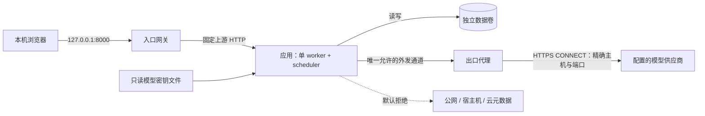

# 运行环境最小权限修复开发方案

> 当前 Docker 镜像仅提供 Python API，不再构建或托管 `/app/frontend/dist`。小程序独立构建上传，详见 [微信小程序开发方案](微信小程序开发方案.md)；本文其余原 Web 路径为历史记录，网关 `frontend` 网络名称仍为部署网络名称。

日期：2026-10-27

状态：代码已实施，应用回归及容器基础验证通过；生产部署验收尚未全部完成。实施记录、差异和未验证项见第 15 节，不能据此认定宿主机全部隔离措施已经生效。

对应问题：《架构与安全Review建议》6.3「运行环境最小权限」。

## 1. 问题与修复目标

当前项目通过 `start.ps1` 直接启动本机 Python/Uvicorn，服务默认监听 `127.0.0.1`。Web API、LangGraph 工作流、模型 HTTP 客户端、SQLite 和定时任务位于同一进程，模型推理在外部供应商运行。

应用已经限制模型可以申请的数据视图、调用用途和输出结构，但缺少运行环境强制执行的权限边界。若后端或依赖出现代码执行漏洞，受影响范围可能扩大到启动账户可访问的文件、凭据和网络；过量请求或异常大响应也可能耗尽服务资源。

这是一项部署隔离与资源控制缺口。现有证据不能证明提示注入已能直接执行 Shell，也不能证明宿主机上的 SSH 密钥或云凭据实际可读。

### 1.1 当前代码依据

以下路径均相对仓库根目录，以实施时实际工作区为准。

| 检查点 | 当前实现 | 缺口 |
| --- | --- | --- |
| 启动身份 | `start.ps1` 直接运行 `.venv` 内的 Python | 没有独立服务账户、权限收缩或容器边界 |
| 文件写入 | `common/config.py` 配置 `data_dir`；`workflows/engine.py` 创建两个数据库 | 指定写入路径不等于禁止写入其他路径 |
| 文件系统 | 直接使用开发目录、源码和依赖 | 没有生产只读文件系统配置 |
| 网络 | `modeling/parser.py` 向配置地址发送请求，禁止重定向 | 未配置网络层默认拒绝；HTTPX 默认可能使用环境代理 |
| 模型执行能力 | 未发现向模型提供的 Shell、任意 Python 或 SQL 执行工具 | 未设置进程级子进程执行限制，不能宣称操作系统已经禁止 Shell |
| 入站大小 | `contracts/workflows.py` 限制聊天正文 4000 字符 | JSON 解析前的完整请求体没有统一字节上限 |
| 出站预算 | `modeling/boundary.py` 单次授权载荷最多 90000 字节；仓储累计调用最多 32 次、400000 字节 | 不覆盖完整 HTTP 请求包及上游响应体大小 |
| 并发 | `workflows/concurrency.py` 提供工作流、会话及数据库锁 | 用于一致性，不能替代全局准入和排队上限 |
| 时间 | 安全分类 HTTP 超时 8 秒，其余 45 秒；工作流有按天计算的过期时间 | HTTPX 分阶段超时与业务保留期限均不等于本轮执行总时限 |
| 凭据 | `common/config.py` 内有硬编码模型 API Key | 凭据与源码、镜像和分发包耦合 |

当前宿主机实际账户、ACL、防火墙和资源配额尚未核验；上述结论针对项目默认运行方式及仓库配置。

### 1.2 修复完成后的行为

1. 提供可复现的加固部署入口，进程使用非 root 身份，代码与依赖只读，仅业务数据和有容量限制的临时空间可写。
2. 不挂载个人主目录、开发配置、SSH/云凭据或 Docker socket。
3. 后端不能直接访问互联网、宿主机服务或云元数据；模型请求只能经过受控出口代理，访问明确配置的供应商主机。
4. 在读取、解析、调度、外发和写入阶段设置资源与执行边界；限制触发后返回稳定错误，保持请求去重、删除保护和已提交数据的语义。
5. 模型密钥从运行时秘密文件读取，不进入源码、镜像层、浏览器、日志和导出。
6. 以真实容器内的正向和负向探测证明权限生效，不能仅凭配置文件存在判定完成。

## 2. 范围、部署档位与兼容约束

### 2.1 本期范围

采用单机 Docker Compose 的 Linux 容器方案：入口网关、单进程应用、出口代理三个服务。保留当前一个 Uvicorn worker、一个内置调度器和两份 SQLite 数据库。

Windows 开发机通过 Docker Desktop 的 Linux 容器运行；加固验收必须分别记录 Linux Docker Engine 与 Windows Docker Desktop 的支持情况。未验证的平台不能标记为满足本方案。

| 档位 | 用途 | 约束 |
| --- | --- | --- |
| `development` | 现有 `start.ps1` 本地调试 | 默认仅监听回环地址；标明没有操作系统级隔离；新增应用限额同样生效 |
| `hardened` | 本期新增加固启动入口 | 必须满足本文的文件、网络、凭据、资源和部署验收；禁止静默降级到开发模式 |

档位由服务端配置决定，客户端请求不能修改。健康状态可以报告配置档位，但不得据此声称已检测到宿主机全部隔离措施。

### 2.2 本期不改变的业务约束

- 保留 `ModelBoundary` 单次授权、持久化调用预算和 `local_only` 的发送限制。
- 保留单进程 SQLite、WAL、checkpoint、receipt、resume_attempt、删除 fence 及重启恢复语义。
- 保留安全分类保守处理、营养估算与表达选择的既有局部降级；不新增隐式模型重试或演示估算。
- 不增加模型可调用的 Shell、任意文件路径、任意 URL、SQL 或代码执行工具。
- 不增加多用户、公网部署、Kubernetes 或微虚拟机。公网部署仍需另行完成认证、TLS、CSRF 和用户隔离。

### 2.3 对“无 Shell 权限”的准确解释

当前项目没有本地模型执行 worker，只有调用外部模型的业务进程。本期要求是“不向模型暴露通用命令执行能力，业务进程运行于受限环境”。

非 root、移除 capabilities、只读文件系统和默认 seccomp 不会自动禁止所有 `execve`；仅删除 `/bin/sh` 也不能阻止 Python 启动其他程序。验收时不得将上述配置写成“操作系统完全禁止子进程”。

未来如需运行模型生成的代码，应新增隔离执行服务与专门设计，按任务或信任边界分配沙箱，不能直接复用持有健康数据库和模型密钥的业务容器。

## 3. 目标架构与信任边界

### 3.1 服务与网络

| 组件 | 网络连接 | 挂载与身份 |
| --- | --- | --- |
| `gateway` | 与应用共享入口内部网络，另接独立 frontend 网络以发布端口；仅发布 `127.0.0.1:8000` | 非 root、只读配置；请求体临时缓存写入限额 tmpfs；没有业务数据和模型密钥 |
| `app` | 仅连接入口内部网络、出口内部网络；无宿主机端口映射 | 固定非 root UID/GID；数据卷 `/data` 可写；`/tmp` 为 tmpfs；模型秘密文件只读 |
| `egress` | 连接出口内部网络与可出网网络；不发布代理端口 | 非 root、只读 ACL；仅必要 DNS 与供应商连接；没有数据库和模型密钥 |

入口与出口内部网络使用 `internal: true`。应用不加入可出网网络，不使用 host 网络、host PID、额外宿主机映射或 `privileged`。[Docker 网络配置](https://docs.docker.com/reference/compose-file/networks/)

`internal: true` 是基础措施，不能单独证明宿主机、网桥网关、IPv6 和平台特殊地址都不可达。交付 `deploy/network-policy.md`，说明支持平台上的主机防火墙或等价网络控制；限制应用仅连接入口必需通信与出口代理端口，出口代理禁止转发到宿主机、私网及元数据地址。实现必须兼容宿主机的 Docker 防火墙后端，不能覆盖或清空 Docker 自动生成的规则。[Docker 防火墙说明](https://docs.docker.com/engine/network/packet-filtering-firewalls/)

网关只反向代理固定应用上游，不支持 CONNECT、动态目标或任意 URL 转发。出口代理不承担公网入站服务。DNS 只使用指定解析器，并在实际连接目标上执行地址检查；不以 DNS 解析成功作为访问授权。

### 3.2 启动与重启

- 应用以 `--workers 1` 启动，不启用 `--reload`，不在运行时安装依赖或执行前端构建。
- 容器内监听 `0.0.0.0` 以供网关访问；宿主机只有网关的回环端口可访问。两者不能混为“应用对公网开放”。
- 启动前验证模型配置、目录可写性、UID、资源参数、代理地址与秘密文件。配置不合法时退出，禁止自动使用源码默认密钥或绕过代理。
- 出口代理暂时不可用时，模型调用按现有故障策略处理；本地读取、取消和隐私清理仍可使用，不改为直连。
- 为崩溃和硬期限回收配置容器重启策略；健康检查失败本身不会保证 Compose 自动重启，需分别验证进程退出与重启策略。

## 4. 文件系统与凭据

### 4.1 镜像和目录权限

采用多阶段构建：Node 阶段执行 `npm ci` 和前端构建，Python 构建阶段按 `backend/requirements.lock.txt` 安装依赖，运行镜像只保留运行所需文件。选择锁定依赖实际支持并通过测试的 Python 版本，不直接假定 Windows 虚拟环境可复制到 Linux。

运行配置至少包含：`user`、`read_only: true`、`cap_drop: [ALL]`、`security_opt: [no-new-privileges:true]`、内存/CPU/PID 限额和 tmpfs。保留默认 seccomp，不使用 `unconfined`。网关和代理也要单独满足自身的非 root、只读与临时目录需求。[Compose 服务配置](https://docs.docker.com/reference/compose-file/services/)

| 路径或资源 | 权限 | 说明 |
| --- | --- | --- |
| `/app/backend`、`/app/frontend/dist`、Python 依赖 | 只读 | 镜像内提供，不绑定整个工作区 |
| `/data` | 仅应用 UID/GID 读写 | 保存 health/checkpoints 数据库及各自 WAL、SHM；挂载整个数据目录，不能只挂载 `.db` |
| `/tmp` | 应用可写、容量受限、重启清空 | 配置 `TMPDIR=/tmp`，支持时设置 `noexec,nosuid,nodev`；noexec 不是脚本解释执行的完整防线 |
| `/run/secrets/model_api_key` | 应用只读 | 唯一必需的供应商秘密文件 |
| 用户主目录、`.ssh`、`.aws`、`.codex`、`.git`、宿主机配置、Docker socket | 不挂载 | 构建与运行都遵守最小包含原则 |

设置 `PYTHONDONTWRITEBYTECODE=1`，日志输出标准流，避免运行时写入源码、依赖、用户主目录或相对路径缓存。数据卷的容量、告警阈值和磁盘满行为单独管理；容器内存限额不会限制持久化磁盘增长。

首次创建数据卷时通过一次性初始化步骤设置所属 UID/GID，业务容器始终以非 root 运行。初始化仅操作明确的数据卷，不能递归修改仓库或用户目录。Windows 绑定挂载的权限语义需实测，默认优先使用命名卷。

### 4.2 模型配置与秘密文件

修改 `common/config.py`，移除硬编码 API Key。生产镜像排除 `.env`，加固档位不自动加载仓库 `.env`，由 Compose 显式传入允许的非敏感配置。

| 配置项 | 规则 |
| --- | --- |
| `RUNTIME_PROFILE` | `development` 或 `hardened`，默认开发档位 |
| `PROCESSING_MODE` | 保留既有语义；纯本地模式不要求模型密钥，不允许外发 |
| `MODEL_BASE_URL`、`MODEL_NAME` | 模型模式显式提供；加固档位仅 HTTPS，不允许用户信息、query、fragment 或不受支持端口 |
| `MODEL_ALLOWED_HOSTS` | 运维配置的精确主机名列表，默认只配置所需供应商；不接受通配符、IP 字面量或请求传入的值 |
| `MODEL_API_KEY_FILE` | 加固档位必需，固定挂载到 `/run/secrets/model_api_key`；读取非空且有长度上限 |
| `MODEL_API_KEY` | 仅开发档位可用；与秘密文件同时提供则报配置冲突，避免来源不明 |
| `MODEL_EGRESS_PROXY` | 加固模型模式必需，固定内部代理服务及端口；不包含认证信息 |
| `DATA_DIR` | 加固档位固定为 `/data`，不接受请求修改 |

主机名规范化后做精确比较，模型 URL、应用 allowlist 与代理 ACL 必须保持一致。供应商切换需要同时更新配置并重新执行网络探测，不能仅修改 URL。

应用显式设置 HTTPX `trust_env=False` 和代理参数；TLS 证书验证保持开启，不能设置 `verify=False`。不要让宿主机 `HTTP_PROXY`、`HTTPS_PROXY`、`ALL_PROXY`、`NO_PROXY` 改变实际出站路径。

本地 Compose secrets 是部署挂载机制，不等于秘密已在磁盘加密；秘密源文件放在构建上下文之外并设置宿主机 ACL。禁止通过构建参数或 Dockerfile `ENV` 烘焙密钥。源码中原有密钥应在迁移后撤销并更换；历史清理另行安排，不把删除当前文件视为撤销凭据。

## 5. 网络出口策略

本期采用支持 HTTPS CONNECT 与访问 ACL 的出口代理，例如 Squid；版本与镜像 digest 在实施时选定并锁定，配置通过语法检查及负向探测后交付。

代理执行以下规则，顺序采用“明确允许，其他全部拒绝”：

1. 只接受应用所在出口内部网络的请求；不向宿主机或公网发布代理端口。
2. 只允许 CONNECT 到配置主机的 443 端口；拒绝任意 HTTP 转发、其他端口、IP 字面量及相似后缀域名。
3. 按连接时解析到的目标地址拒绝回环、私网、链路本地、保留/特殊用途、云元数据和 IPv6 等价地址；DNS 重绑定也不能绕过。
4. 只放行必要 DNS 解析流量；禁止把任意 DNS、备用代理或直接 TCP 作为外发通道。
5. 不解密供应商 TLS，不读取健康正文或 Authorization；访问日志仅记录必要连接元数据，不记录完整查询参数或请求体。
6. 禁止应用绕过代理直连；即使 HTTPX 代理参数被代码移除，网络层仍需阻断。

生产运行不开放 pip、npm、Git 或通用下载源；依赖下载只发生在受控构建阶段。后续可信数据源按独立用途和目标增加，不开放任意 URL 抓取。

域名 allowlist 只能限制目的地，不能阻止向已批准供应商多发数据。因此已有数据投影、授权、调用预算与纯本地模式必须继续执行。

## 6. 分层资源限制

以下是本项目的初始工程参数，不是行业统一标准。实施时用合成数据在目标机器上验证，参数调整需更新部署配置和测试依据。

| 层级 | 初始值 | 实现与说明 |
| --- | --- | --- |
| 完整 HTTP 请求体 | 64 KiB，即 65536 字节 | 网关与 ASGI 双重限制；按实际接收字节计数，不能仅检查 Content-Length |
| 请求体接收总时间 | 10 秒 | 从开始接收正文计时；网关空闲超时不能替代该总时限 |
| 请求头 | 8 KiB/字段、有限数量与总量 | 网关限制并通过实际服务器行为测试；客户端不能靠超多小字段绕过 |
| 活跃工作流执行 | 全局 2 个 | 前台与 scheduler 共用；无业务等待队列，满额立即返回 503 |
| 管理操作通道 | 1 个活跃操作、无等待队列 | 取消、删除/重试清理等保留容量，不被慢模型占满；仍执行现有业务锁与 fence |
| 总 HTTP 连接/处理保护 | Uvicorn 初始 `--limit-concurrency 32` | 作为最外层兜底，不替代业务准入；另行验证健康与取消可达性 |
| 单次模型响应体 | 1 MiB 解压后正文 | 先有界读取再 JSON 解析；同时限制传输字节，拒绝或限制压缩编码 |
| 单次模型调用总时限 | 安全分类 8 秒，其他 45 秒 | 额外实施总 deadline；保留更短的连接、读取、写入与连接池超时 |
| 本轮工作流执行期限 | 120 秒 | 不包含用户等待补充的时间；包含本轮等待锁、模型、解析和写入 |
| 超期硬回收 | 正常 watchdog 在 135 秒回收，进程外监督最迟 150 秒回收 | 120 秒业务期限 + 15 秒宽限 + 最多 15 秒故障检测/终止余量；见第 8 节 |
| 应用容器 | CPU 1 核、内存 512 MiB、PID 128 | 显式配置 `cpus`、`mem_limit`、`pids_limit`，通过运行时 inspect 与压力测试确认 |
| 应用临时目录 | 64 MiB tmpfs | 随容器重启清空；限制临时文件增长 |
| 网关、代理 | 各 CPU 0.5 核、内存 128 MiB、PID 64 | 独立配额及有限缓存；代理连接时长配合模型调用总期限 |
| 日志 | 每服务 10 MiB × 3 个轮转文件 | 不记录健康正文、模型响应、密钥或错误对象全文 |

进程数限额在 Linux 可能同时影响线程，128 需覆盖 Uvicorn、同步端点、LangGraph 和 checkpoint 线程后再锁定。只写 `deploy.resources` 而未证明当前 Compose 实际执行配额，不算通过。

保留现有 4000 字符字段校验、90000 字节单次模型授权载荷与工作流累计调用/字节预算。它们与新增限额分别保护不同阶段，不互相替代。

## 7. 应用层改造

### 7.1 在 JSON 解析前限制请求体

新增纯 ASGI `RequestLimitsMiddleware`，置于请求追踪包裹层之内、路由和 JSON 解析之前，确保错误响应有服务端生成的 `X-Request-ID`。

本项目没有文件上传或无限请求流，本期可采用有界缓冲：先接收至多 64 KiB 正文，在 10 秒内完成，然后将有限缓冲重放给下游。这样可以在业务函数启动前确定大小和读取期限，避免处理中途抛出大小异常后发生写入。

- Content-Length 明确超限时立即返回 413；缺少或不可信时仍累计实际 ASGI chunk 字节数。
- 覆盖分块传输、空包、声明长度不符、断开连接；协议非法输入允许由网关/服务器直接拒绝。
- 拒绝请求 `Content-Encoding` 压缩形式，返回 415，避免在未定义解压上限时接受压缩炸弹。
- 检查总期限，不能在每个 chunk 到达后重新开始计时。
- 拒绝前不注册工作流、不写健康数据、不调用模型；断开连接及时释放缓冲和准入资源。
- 网关也设置大小、连接和空闲超时；其拒绝响应采用固定错误模板，不回显输入。

NGINX 的 `client_body_timeout` 是相邻读取操作的超时，不是整个上传总时限。本期明确配置 `proxy_request_buffering off` 与 `proxy_http_version 1.1`，将正文及时转发至 ASGI，由应用实施绝对正文期限；网关保留大小、请求头期限及连接限制。通过真实网关验证 chunk 转发与背压，不得只配置 `client_body_timeout=10s` 后声称覆盖慢速滴流。[NGINX 正文超时](https://nginx.org/en/docs/http/ngx_http_core_module.html#client_body_timeout)、[请求转发缓冲](https://nginx.org/en/docs/http/ngx_http_proxy_module.html#proxy_request_buffering)

### 7.2 全局准入与管理操作

新增 `RuntimeLimiter`，在 Engine 入口共用，覆盖 `run()`、真正继续执行的 `resume()`、scheduler 触发的工作流及新增模型调用入口。不得仅在 `/api/chat` 端点限制。

- 使用非阻塞的计数/信号量；容量不足返回固定 503 与短 `Retry-After`，不建立无限排队。
- 工作流执行槽覆盖锁等待和实际运行，直到真实操作结束才能释放；HTTP 客户端断开或外层超时不能提前释放。
- 已完成 receipt 的只读重放不重复占用模型执行槽；未完成请求重试和 resume 仍需准入，继续服从 request/workflow/conversation 锁。
- scheduler 满额时跳过或延后本轮，不创建无限后台任务，不破坏已有 job receipt；其触发的工作流同样受限。
- 模型 HTTP I/O 继续释放 `engine.lock`，保持删除和取消能够推进。管理通道只保留执行容量，不允许绕过数据库一致性检查。
- 限制 HTTP 层连接、正文接收数量，避免大量请求在到达 Engine 前耗尽同步线程池。对读接口、导出及静态资源制定有限连接策略。

### 7.3 模型响应有界读取

修改 `Parser.model_request()` 的传输实现，保留 `boundary.consume()` 在打开网络前执行以及失败调用计入预算的顺序。

1. 使用流式 HTTP 传输读取普通 Chat Completions 响应；这里的流式仅用于有界读取，不启用供应商 SSE 或改变前端成功协议。
2. 禁止重定向，显式代理、`trust_env=False`、TLS 校验、连接数与分阶段超时；发送 `Accept-Encoding: identity`，对意外压缩编码采用拒绝策略。
3. Content-Length 超限可提前拒绝；无长度或伪造长度时持续计数，正文超过 1 MiB 立即关闭连接，不继续缓冲。
4. 在响应头、每个读取 chunk 及 JSON/Schema 校验前检查本轮 deadline；确保单次调用总期限能够中断缓慢滴流，不能仅依赖每次读取的空闲超时。
5. 在有界完整正文上解析 envelope 和 Pydantic 输出；非法 JSON、Schema、编码及响应结构继续使用既有上游错误语义。
6. 非成功 HTTP 响应也需关闭或有界丢弃，不能为打印上游错误而读取无限正文。不得把上游正文或异常链记录到日志。

传输实现明确采用 `httpx.AsyncClient`、`asyncio.timeout()` 和异步正文读取，在超期时取消并关闭 HTTP 连接。当前 Engine 在同步端点/工作线程执行，`Parser.model_request()` 在同一个工作线程内通过 `asyncio.run()` 调用独立的异步传输函数；`model_io` 的释放与重新获取仍在原线程，异步传输不访问仓储或业务锁。若未来调用线程已经存在运行中的事件循环，应调整入口，不能嵌套 `asyncio.run()` 或创建没有退出管理的线程池。

每次调用独立管理客户端生命周期，先保证可取消与无泄漏，再评估复用连接；本期不引入全局后台事件循环。必须验证“持续滴流也按总期限断开”，不能以取消一个线程池 future 代替网络取消。HTTPX 的分阶段超时继续作为较短故障保护。[HTTPX 超时语义](https://www.python-httpx.org/advanced/timeouts/)

## 8. 执行总期限、停止与恢复

### 8.1 本轮 deadline

新增不持久化的 `ExecutionBudget`，以单调时钟保存本轮起点、deadline 和停止原因，并通过 ContextVar 传递。Web 和 scheduler 使用相同机制。

- 在 Engine 入口、锁获取/等待、每个图节点前后、外发前后、写事务入口、计划激活和返回结果前检查预算。
- `KeyedLocks.hold()` 增加剩余时间限制，避免在锁上无限等待；重入锁的嵌套调用不能重置期限。
- 单次模型总期限取用途上限与本轮剩余预算的较小值，授权和预算登记规则保持不变。
- 所有业务提交路径均需检查停止标记；提交前预留清理时间，禁止超期后再启动新的业务事务、模型调用或建议生成。
- deadline 错误不能被宽泛的营养/表达降级捕获后继续业务；安全分类仍返回本地保守结果，但不得因此重开流程或获得新预算。
- 等待用户补充属于已结束的执行轮次，不占用槽位和 120 秒预算；下一次有效 resume 获得新的本轮预算，原工作流持久化模型调用预算继续累计。

### 8.2 同步线程的硬回收边界

Python 同步线程不能靠取消 HTTP 请求或 `wait_for()` 安全终止。本期保留单进程架构，采用“合作式停止 + 超期进程整体回收”的明确边界：

1. 到达 120 秒标记停止，拒绝该执行继续申请权限；能正常退出时按固定错误结束并释放资源。
2. 独立于 Engine/仓储锁的 watchdog 维护执行登记；超期执行在 15 秒宽限后仍未真实结束，则让应用进程以非零状态退出，由运行平台重启。watchdog 不能依赖被阻塞的业务线程池。
3. 硬回收影响同进程其他请求与 scheduler，这是当前单用户、单进程方案的可接受代价，必须在运维说明中明确；不能宣称实现了单任务强制终止。
4. 不能在超期响应发出时直接注销仍运行的执行、释放其槽位或取消 watchdog 登记，否则后台任务将逃逸限制。
5. watchdog 线程也不能保证处理进程失去调度、阻塞在持有 GIL 的原生扩展等所有情形，部署层必须有独立监督。应用每秒原子更新 `/tmp/runtime-status.json`，只记录单调时间、活跃执行期限和真实完成状态，不包含输入或健康数据；独立 healthcheck 进程检查心跳、执行期限和启动就绪状态，不能只请求可能同样阻塞的业务 API。
6. 新增宿主机 `scripts/supervise-runtime.py`，在可信控制面调用 Docker CLI，每 2 秒核验固定 Compose 项目/服务标签及容器健康状态。healthcheck 每 2 秒执行、单次上限 1 秒、失败 1 次即报告不健康；启动恢复阶段最多 60 秒且期间不开放业务，就绪后超过 5 秒未更新心跳、过了 135 秒仍有活跃执行或状态文件非法均判失败。监督器只回收核对过标签的应用容器，停止宽限至多 5 秒，确保正常部署条件下整轮最迟 150 秒终止。宿主机整体失去调度属于平台故障，不能由应用保证实时截止。
7. 监督器在 Linux 由 systemd、在 Windows 由后台计划任务等宿主机机制托管，持有必要的 Docker 管理权限；应用、网关和代理都不获得 Docker socket。它是信任边界外的运维组件，不接受模型输出、任意容器名或 HTTP 参数作为命令。10 分钟内自动回收超过 3 次时停止接收新业务并报告需运维处理，不能无限重启。

硬期限验收必须包含“锁阻塞、持续上游滴流、同步工作仍未退出、进程整体无响应”场景。平台没有独立回收能力时，只能报告合作式期限已实现，本项加固验收不通过；不得把 CPU/内存配额当作时间上限。

### 8.3 数据与重试语义

- 超时前已经提交的独立记录保留，不能声称整轮事务回滚；未提交事务由 SQLite 回滚/恢复。
- checkpoint、消息、调用预算、receipt 和 resume attempt 必须继续使用现有幂等关系，不能因超时清空预算或创建新 request_id。
- 硬回收后先执行现有数据库、checkpoint 和删除任务恢复，再开放就绪状态。不得忽略失败恢复后直接接受写入。
- 响应已发送、响应丢失、工作已部分提交、checkpoint 未完成等场景由同一请求重试和已有恢复规则核实；前端提示使用原请求重试或刷新，不自动生成新请求。
- 对因硬回收无法回传的请求，允许网关返回固定 502/503；不能保证每次都收到应用层 504。

本节回收机制需要实际故障注入验证两份数据库的恢复与跨库业务一致性，SQLite WAL 能恢复不等于业务结果必然完整。

## 9. 错误契约与可观测性

复用 `common/errors.py`、`api/errors.py`、`api/request_context.py` 的固定错误注册表、脱敏 envelope 和追踪 ID，新增最少必要错误类型与码。

| 场景 | 状态码 | 固定错误码 | 处理 |
| --- | --- | --- | --- |
| 完整请求体超限 | 413 | `request_body_too_large` | 不执行业务 |
| 请求体接收总期限到达 | 408 | `request_body_timeout` | 关闭接收，不执行业务 |
| 不支持的请求压缩 | 415 | `request_encoding_unsupported` | 不解压处理 |
| 执行容量已满 | 503 | `runtime_busy` | 返回有限 Retry-After，不自动重试模型 |
| 本轮执行超期 | 504 | `execution_deadline_exceeded` | 停止继续业务；如已有提交，重试时核实结果 |
| 模型响应超限 | 502 | `model_response_too_large` | 关闭连接；局部降级仅沿用原业务允许的路径 |
| 模型调用总期限到达 | 503 | 复用 `model_unavailable` | 保留既有模型故障语义；本轮也已超期则执行 deadline 语义 |
| 部署配置不合法 | 启动失败 | 固定配置错误标识 | 仅记录缺失字段名或规则名，不输出字段值 |

网关拒绝请求时统一产生自己的追踪 ID 与固定 JSON；应用错误保留应用生成的 ID，网关不能用客户端头覆盖。请求尚未进入应用时，不要求产生业务 request_id。

新增指标仅含计数与耗时：活跃执行数、拒绝数、超时数、响应超限数、硬回收数、模型调用元数据和资源峰值。日志与指标禁止健康正文、完整 URL、秘密文件内容、Authorization 和上游响应。网关及出口代理日志同样适用。

前端沿用当前错误消费，补充 413/408/415/503/504 的固定提示；部分提交或响应不确定时保持原幂等键，不静默重新提交。

## 10. 文件级实施范围

以下为计划文件范围；当前实现情况与实际新增文件见第 15 节，部署策略仍需在目标环境验证。

| 文件 | 变更 |
| --- | --- |
| `Dockerfile`、`.dockerignore` | 多阶段构建、非 root、最小运行内容；排除 data、output、Git、虚拟环境、秘密与开发配置 |
| `compose.hardened.yaml` | 三服务、隔离网络、回环发布、数据卷、只读根文件系统、secrets、资源配额、重启配置 |
| `deploy/gateway/nginx.conf` | 固定上游、请求大小/连接限制、明确的缓冲与总期限策略、错误模板及有限日志 |
| `deploy/egress/squid.conf` | 精确供应商 ACL、CONNECT 限制、特殊地址拒绝、默认拒绝与脱敏日志 |
| `deploy/network-policy.md` | Linux/Docker Desktop 平台支持、宿主机与元数据隔离、部署前置条件及撤销步骤 |
| `deploy/health-supervision.md` | 进程外心跳、超期回收、重启风暴控制和运维恢复步骤；不得只写健康检查而没有执行者 |
| `scripts/supervise-runtime.py`、`scripts/runtime-healthcheck.py` | 宿主机监督、固定服务身份校验、心跳/执行期限检查、有限重启；部署中必须实际托管运行 |
| `scripts/start-hardened.ps1` | 配置与运行平台前置检查、启动 Compose、失败时不回退到本机 Python |
| `scripts/verify-runtime.ps1`、`scripts/verify-runtime.py` | 编排检查与容器内权限/网络/配额探测；使用合成数据，输出脱敏报告 |
| `backend/app/common/config.py` | 秘密文件读取、严格档位与限额配置、URL/主机/代理验证，移除源码密钥 |
| `backend/app/common/errors.py`、`backend/app/api/errors.py` | 新错误类型、固定状态码/文案和 Retry-After 支持 |
| `backend/app/api/request_limits.py` | ASGI 解析前大小、编码、接收总期限与有界缓冲 |
| `backend/app/api/request_context.py`、`backend/app/main.py` | 中间件顺序与生命周期，部署资源初始化/关闭、就绪状态 |
| `backend/app/common/execution_budget.py` | 单调时钟预算、停止标记、非阻塞准入、watchdog 执行登记 |
| `backend/app/workflows/engine.py`、`runtime.py`、`concurrency.py` | 共用准入、锁等待期限、节点/提交检查、恢复与真实执行结束的资源释放 |
| `backend/app/modeling/parser.py`、拟新增 `transport.py` | 显式代理、有界响应、可中断总时限与连接清理 |
| `backend/app/jobs/scheduler.py` | 共用执行槽、预算和超期处理，容量满时不积压 |
| `backend/app/api/deletions.py`、`workflows.py` 及相关写入入口 | 管理操作通道与提交边界检查，防止遗漏旁路 |
| `frontend/src/api.ts`、相关提示逻辑 | 消费新增错误，保持幂等与部分成功语义 |
| `.env.example`、`README.md`、`start.ps1` | 删除硬编码配置说明，区分开发与加固入口，提供秘密文件及数据迁移说明 |
| `backend/tests/test_config.py` | 修改当前“环境变量不能覆盖内置模型配置”的测试，验证显式配置、秘密文件与安全默认值 |
| `backend/tests/model_helpers.py` 及现有模型测试夹具 | 现有多处 monkeypatch `httpx.Client`；迁移为可注入的异步 MockTransport/统一传输夹具，保持安全分类与业务模型隔离，不让测试意外访问真实供应商 |
| 新增资源/网络/恢复测试及部署探测 | 见第 11 节 |

实施时若为可靠网络取消新增异步桥接或监督模块，应在提交说明中补充文件及退出生命周期；不允许留下没有调用入口的限额模块。

## 11. 验收标准与验证矩阵

单元/集成测试使用 mock 模型和独立临时数据库；部署测试使用专用测试卷、合成健康数据、假密钥和受控 TLS 目标。不得复制真实数据库或用真实个人秘密文件执行探测。

| 编号 | 验收条件 | 验证方式 |
| --- | --- | --- |
| AC-01 | 非 root、只读代码和依赖，仅数据/临时目录可写 | inspect + 容器内用应用 UID 实测：读取应用成功、写源码失败、写 `/data` 与 `/tmp` 成功；secret 写入失败 |
| AC-02 | 无主目录、SSH/云/开发凭据、Docker socket 挂载 | 检查构建上下文、镜像与全部 Mounts；宿主机放置无敏感哨兵文件，确认容器不可见；不检查真实密钥正文 |
| AC-03 | 只有网关回环端口发布，应用和代理不发布 | 检查 Compose 展开结果与实际端口；宿主机访问网关成功，局域网访问拒绝 |
| AC-04 | 应用绕过代理也不能外连 | 从实际应用容器移除/忽略代理，尝试直接 TCP/HTTPS 到受控公网地址失败；仅检查 Python 业务路径不算通过 |
| AC-05 | 代理仅放行批准目标，拒绝特殊地址和 DNS 重绑定 | 准许测试主机 TLS 请求成功；其他域名、相似后缀、IP CONNECT、其他端口、IPv4/IPv6 私网/回环/元数据均失败；使用可控 DNS 模拟换址 |
| AC-06 | 无宿主机/网桥/平台特殊地址旁路 | 实测网桥网关、可解析的 `host.docker.internal`、宿主机监听服务与 IPv6 路径；未启用 IPv6 时记录无法路由而非跳过结果 |
| AC-07 | 配置与秘密不泄露，配置无效即退出 | 测试缺失/冲突密钥、非 HTTPS、私有/IP/相似域名、代理污染、不可写目录；扫描源码、镜像历史和日志中的测试秘密标记 |
| AC-08 | 请求体限额在业务和 JSON 解析前生效 | 精确边界 65536/65537 字节、无 Content-Length、多 chunk、错误长度、压缩体、断连；拒绝时无 workflow、数据、调用预算或外发副作用 |
| AC-09 | 慢速滴流不能无限占用接收资源 | 每次间隔小于空闲超时但总长超过 10 秒，通过真实网关和直接 ASGI 两条路径验证；断连后资源恢复 |
| AC-10 | 活跃工作流最多 2 个、满额不排队 | 用不同 request/conversation 挂起两个模型请求，第 3 个立即 503；scheduler 同样限流；取消和删除仍能进入管理通道 |
| AC-11 | 准入与原有幂等/锁兼容 | 相同请求重放、并发重复请求、resume 重试、模型慢调用时删除/取消、异常与断连释放；slot 只在真实执行结束时归还 |
| AC-12 | 上游响应超限、异常压缩和滴流均受控 | 使用本地 TLS 模拟服务发送大响应、缺长度、假长度、非成功大错误体、压缩编码及慢滴流；内存有界，连接关闭，原文不入日志 |
| AC-13 | 总 deadline 覆盖节点、锁等待、模型和提交 | 注入时钟与阻塞点；超期不新建业务写入、不外发、不降级继续执行；管理操作遵守原 fence |
| AC-14 | 同步任务超期后确实回收 | 故意让执行不响应合作式取消，验证宽限后退出重启；另测进程无心跳，由进程外监督回收；不能只断言 HTTP 504 |
| AC-15 | 硬回收后数据可恢复、重试不重复写 | 在独立记录提交、checkpoint、resume、删除过程中注入回收；两库完整性检查、恢复 fence/预算/receipt，原幂等键重试结果一致或明确可恢复 |
| AC-16 | 配额实际生效，磁盘满行为明确 | inspect 核对 CPU/内存/PID/tmpfs/日志轮转；隔离测试卷内压力验证；OOM 后恢复、磁盘满时拒绝写且不输出假成功 |
| AC-17 | 纯本地模式仍无外发 | 开启请求级和服务端 local_only，覆盖新建/恢复/scheduler；代理记录中没有模型请求，不能因缺密钥切到演示营养 |
| AC-18 | 原业务和前端错误消费不回归 | 运行模型边界、安全路由、并发、恢复、隐私删除、模型/配置及前端相关测试；保留已有请求 ID 与脱敏契约 |

部署探测至少输出：平台/运行时版本、镜像 digest、配置摘要、实际 UID、配额、挂载目标、每项探测的通过/失败/未验证与时间戳。禁止包含环境变量全集、秘密值、健康数据或模型请求正文。

生成测试专用 Compose override 时只替换供应商主机、假密钥和测试卷，不放宽网络拒绝、root 身份、只读或配额。最终交付还要核对正式配置的精确目标与 ACL 一致；真实供应商连通性测试只发送合成内容并明确记录是否执行。

### 11.1 验证执行原则

建议测试文件：`test_request_limits.py`、`test_execution_budget.py`、`test_model_transport_limits.py`、`test_runtime_admission.py`、`test_runtime_recovery.py`。现有 `test_config.py`、`test_harness.py`、`test_safety_routing.py`、`test_workflow_concurrency.py`、`test_resume_recovery.py`、`test_privacy_deletion.py` 同步回归。

Docker 不可用或宿主机策略未配置时，应用测试可以继续，但部署验收必须记为未验证；mock 网络测试不能替代 AC-04～06。测试临时目录显式指向独立可写位置，测试挂起时给测试进程设置外部超时，不将环境阻塞报告成产品测试通过。

本方案不新增业务数据库 schema。若实施发现必须持久化新的恢复状态，先补充迁移、跨版本恢复与回滚方案，并更新本节验收，不能偷偷借用无关 meta 字段。

## 12. 实施顺序与交付门槛

| 任务 | 实施内容 | 完成证据 |
| --- | --- | --- |
| T1 | 模型配置、秘密文件、URL/代理白名单及错误注册 | AC-07；更新配置测试和 `.env.example` |
| T2 | Dockerfile、只读/非 root/数据卷和资源配额 | AC-01～03、16；镜像构建与实际 inspect |
| T3 | 网关、出口代理与平台网络策略 | AC-04～06；正反向探测报告，不能以“代理可访问”代替禁止直连 |
| T4 | ASGI 完整正文限制、接收期限与网关协同 | AC-08～09；确认中间件顺序和拒绝无副作用 |
| T5 | Engine 准入、管理通道、单调时钟预算和模型有界传输 | AC-10～13、17；覆盖 scheduler 与恢复入口 |
| T6 | watchdog、进程外监督与故障恢复 | AC-14～15；真实回收、两库恢复和原请求重试证据 |
| T7 | 前端消费、启动说明、数据迁移和完整回归 | AC-18；所有必需验收项没有失败或未验证 |

T1/T2 可先独立落地以降低凭据和文件风险；T3～T6 完成前不得将整体问题关闭或把加固入口作为已验收发布。部署脚本不得自行放宽宿主机全局防火墙、修改个人目录 ACL 或关闭 TLS 来修复失败探测。

## 13. 上线、数据迁移与回退

1. 在测试卷完成构建、探测、故障注入和业务回归，固定依赖、镜像 digest 与运行平台版本。构建源文件清单采用允许列表，避免新增文件意外进入镜像。
2. 停止原本机服务，确认数据库连接关闭。使用 SQLite 备份 API或停机后的完整一致性副本备份两份数据库；不能在运行中只复制 `.db` 而遗漏 WAL。
3. 把备份恢复到新命名卷，设置应用 UID/GID，验证健康数据、待补工作流、计划、删除任务和恢复结果。两个实例不能同时操作同一份数据。
4. 在宿主机创建具有受限 ACL 的秘密源文件，配置模型主机、代理、网络策略和资源限额；撤销原源码密钥，更新所有必需使用方。
5. 启动加固入口，核对只有回环网关端口、真实非 root、只读/挂载/配额和网络拒绝均符合预期，再执行合成数据冒烟。
6. 观察拒绝率、内存峰值、模型耗时、硬回收和数据恢复；参数不合适时调整具体限额并重测，不通过切回 root、可写根文件系统或全网放行绕过。

回退优先使用上一个已验收加固镜像和兼容配置，保留数据卷、有效新密钥与网络边界。本期不做 schema 迁移，但仍需验证旧镜像与实际数据兼容。若只有开发模式可以运行，应先停服务并记录隔离能力下降，不能由启动脚本静默回退。恢复备份可能丢失之后的记录，必须明确恢复点。

## 14. 设计依据与采用边界

资料核对日期：2026-10-27。下列是官方安全基线与公开工程实践，支持本文设计方向，不表示所有企业使用完全相同的组件或参数。

- [OWASP：Excessive Agency](https://genai.owasp.org/llmrisk/llm062025-excessive-agency/)：按任务收缩工具功能与权限。本项目继续由本地代码授权，不给模型通用执行工具。
- [Anthropic：Claude Code 沙箱实践](https://www.anthropic.com/research/claude-code-sandboxing)：同时实施文件与网络隔离，并以沙箱外代理执行出口控制。本项目借鉴边界设计，不引入编码 Agent 或 Shell 能力。
- [Docker：Compose 服务配置](https://docs.docker.com/reference/compose-file/services/)：非 root、只读根文件系统、挂载、secrets 和资源配置的实现依据；配置是否生效仍需部署验证。
- [Docker：Compose 网络配置](https://docs.docker.com/reference/compose-file/networks/)：以内部网络隔离应用直接外连；宿主机与特殊地址仍需平台验证与附加策略。
- [Docker：防火墙与包过滤](https://docs.docker.com/engine/network/packet-filtering-firewalls/)：Docker 自有规则、宿主机防火墙和发布端口需要协同，不能只凭宿主机通用防火墙配置推断安全。
- [HTTPX：Timeouts](https://www.python-httpx.org/advanced/timeouts/)：connect/read/write/pool 超时分别保护不同阶段，读取超时按数据块等待时间计算，不能替代绝对执行期限。
- [NGINX：client_body_timeout](https://nginx.org/en/docs/http/ngx_http_core_module.html#client_body_timeout)：正文空闲超时不等于上传总期限，本文要求通过真实入口验证慢速滴流。
- [NGINX：proxy_request_buffering](https://nginx.org/en/docs/http/ngx_http_proxy_module.html#proxy_request_buffering)：关闭请求预缓冲并明确上游 HTTP 版本，使 ASGI 正文期限能覆盖入口滴流。
- [Python：asyncio.run](https://docs.python.org/3/library/asyncio-runner.html#asyncio.run)、[asyncio.timeout](https://docs.python.org/3/library/asyncio-task.html#asyncio.timeout)：同步工作线程内的事件循环生命周期与异步 I/O 总期限；不把合作式任务取消当作同步线程强制终止。

## 15. 实施记录与剩余验收

### 15.1 已实施内容

1. `common/config.py` 移除内置模型密钥，增加环境/秘密文件来源、加固档位、精确主机及代理校验；不完整配置在启动时失败。开发环境无模型配置时显式使用原有演示模式。
2. 新增 `api/request_limits.py`，在业务和 JSON 解析前有界读取完整正文，限制分块正文、绝对接收时间、压缩形式及请求头。网关关闭预缓冲，与 ASGI 的总接收期限配合。
3. 新增 `common/execution_budget.py`，实现工作流 2 槽、管理操作 1 槽、本地读写 8 槽、单调期限及有界锁等待；`run/resume` 的完成结果重放可不占执行槽。删除执行端点在查询预览前即进入管理通道，scheduler 与工作流共享限制。
4. 新增 `modeling/transport.py`，使用 AsyncClient、显式代理、禁用环境代理、绝对调用期限及有界原始响应读取；拒绝压缩响应并保留调用预算、授权顺序和现有局部降级。
5. 新增 `BudgetConnection`，在连接级 SQL 和提交入口检查预算，超期事务回滚；checkpoint 的显式提交也受限。真实同步执行未结束时不释放其登记与槽位。
6. 新增非 root、只读、多阶段镜像及三服务 Compose，锁定 Python/Node/NGINX/Debian 基础镜像摘要；数据和临时目录隔离，模型秘密只读挂载，不挂载工作区。Squid 默认拒绝其他主机、端口、IP 字面量与特殊地址。
7. 新增 watchdog、独立 healthcheck、宿主机监督与有限重启、Linux 显式网络策略脚本、部署探测和合成冒烟脚本；前端补充资源错误的安全提示，不自动更换幂等键或重试。

实际新增的验证脚本还包括 `scripts/test-runtime-deployment.py` 和 `scripts/test-runtime-supervision.py`。后者只允许固定的合成测试项目，不能对真实个人数据服务做故障注入。

### 15.2 实现差异与环境

- 验证环境为 Windows 上 Docker Desktop 的 Linux 容器，Docker Engine `29.6.2`、Compose `v5.3.1`。Linux 宿主机防火墙脚本尚未在真实 Linux Engine 上执行，不标记通过。
- Docker Hub 鉴权拉取失败，改用可访问的 Docker Official Images 公共镜像源 `public.ecr.aws/docker/library/`；四个基础镜像已按实际拉取结果固定 digest。
- Docker Desktop 的网关仅接 internal 网络时未能发布回环端口，因此增加网关专属 frontend 网络。应用仍只连接两个内部网络，未获得外网连接。
- 网关为全部已启用的临时目录显式配置 `/tmp`，Squid 关闭非必需的 ICMP pinger 并降低缓存内存；没有通过增加 capabilities 或取消只读修复启动问题。
- `verify-runtime.py` 是基础探测报告，不是完整生产认证器：未完成的受控网络、DNS 换址、宿主机策略和压力测试仍列为 `unverified`，不会自动输出 `accepted=true`。

### 15.3 验证证据

| 范围 | 结果与依据 |
| --- | --- |
| 应用回归与构建 | 后端、前端的最终命令结果另存 `evidence/runtime-validation-summary.json`；全部模型调用由测试桩处理，数据库使用独立临时目录 |
| 容器身份、挂载、资源和基础拒绝探测 | `evidence/runtime-container-probes.json`；非 root、只读、cap_drop/no-new-privileges、秘密只读、内存/CPU/PID、目录写入及基础网络拒绝已实测；该报告明确保持整体未验收 |
| 真实网关和代理 | `evidence/runtime-gateway-smoke.json`；64 KiB 边界、压缩正文、持续滴流绝对超时、local_only/幂等、合成记录删除、非白名单和特殊目标拒绝；允许目标仅建立 CONNECT，不发送模型请求 |
| 期限与恢复专项 | `test_runtime_limits.py`、`test_model_transport_limits.py`、`test_runtime_recovery.py` 覆盖容量、锁等待、同步工作真实退出、两库未提交事务回滚和完整性；`evidence/runtime-supervision.json` 记录独立监督的容器故障注入结果 |

### 15.4 AC 状态与不能关闭的事项

| 验收项 | 当前状态 |
| --- | --- |
| AC-01～03 | 测试部署的身份、只读/目录、挂载和回环发布已验证；未做真实个人凭据或 LAN 设备读取测试 |
| AC-04～06 | 基础直连拒绝与代理拒绝/允许路径已验证；受控公网正反对照、DNS 重绑定、宿主机防火墙与完整 IPv6 验证待完成 |
| AC-07 | 配置/来源、秘密不回显与测试秘密文件注入已验证；原密钥供应商侧撤销及正式新密钥注入由部署方完成，未执行真实凭据操作 |
| AC-08～13 | 应用专项、既有回归及真实网关正文/代理探测通过；完整模型 TLS 故障场景仍以 mock 字节流验证，不标记为真实供应商负载测试 |
| AC-14～15 | 子进程硬退出及两库事务恢复已验证；容器外监督结果见单独报告；全部业务提交阶段的容器回收、删除/resume 故障注入和迁移回退演练仍需补齐 |
| AC-16 | 配额配置已运行时核对；OOM、PID、磁盘满和 CPU 压力测试未全部执行，不操作真实宿主机磁盘制造故障 |
| AC-17～18 | 纯本地零外发、既有后端/前端回归和构建通过，详细数量见汇总报告 |

代码修改未迁移、复制或破坏当前个人数据库；测试项目使用独立命名卷、18000 端口和假密钥。原工作区已有的数据库 WAL 和分析 HTML 改动不属于本项交付。

在上述网络策略、正式密钥和生产恢复/压力验证完成前，本问题只能标记“代码修复已交付，生产加固验收待完成”，不能标记整体安全问题已关闭。
